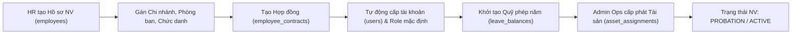
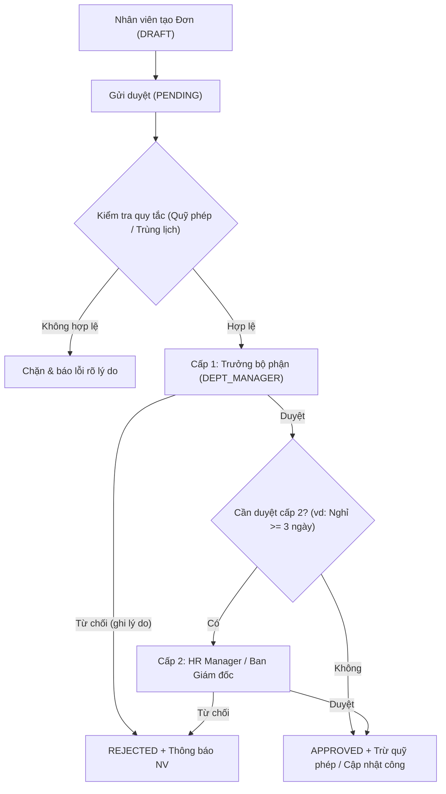
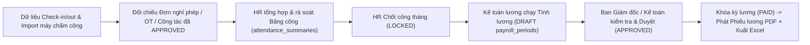

# System Blueprint: Operon Hub — Enterprise Operations Portal & HRM Module

> Tài liệu thiết kế kiến trúc tổng thể cho hệ thống **Operon Hub** — Cổng quản lý vận hành doanh nghiệp vừa và nhỏ (SME). Thiết kế theo kiến trúc **Modular Monolith** trên **Next.js (App Router) + MySQL**, tách biệt rõ **Core Platform** (tái sử dụng cho mọi phân hệ) và **Business Modules** (triển khai trước **HRM**, sẵn sàng cắm **CRM**, **Finance**, **Project** mà không sửa lõi).

---

## 1. Tổng quan Kiến trúc & Phân quyền (Actors & RBAC)

### 1.1. Nguyên tắc Kiến trúc Portal Đa Phân hệ
- **Mô hình tổ chức:** **Single-Tenant Multi-Branch** — phục vụ 1 doanh nghiệp với nhiều chi nhánh/văn phòng/công ty thành viên (`branches`).
- **Module Registry (Cắm-rút phân hệ):** Mọi phân hệ (`hrm`, tương lai `crm`, `finance`...) đăng ký qua 1 manifest trung tâm (`src/modules/registry.ts`) gồm `code`, `name`, `icon`, `basePath`, `requiredPermissions`, `navItems`. Sidebar và Middleware tự động ẩn/hiện phân hệ theo quyền và cấu hình bật/tắt trong bảng `settings`.
- **Cross-Module Shared Engines (Đặt tại Core):**
  - **Auth & RBAC Engine:** Xác thực JWT (Access + Refresh Token lưu DB), phân quyền theo **Permission Key** (`<module>.<resource>.<action>`) kết hợp **Data Scope** (`OWN`, `DEPARTMENT`, `BRANCH`, `ALL`).
  - **Universal Approval Engine:** Động cơ duyệt đơn đa cấp dùng chung — giai đoạn 1 phục vụ đơn nghỉ phép/tăng ca/công tác (HRM), giai đoạn sau tái sử dụng trực tiếp cho duyệt báo giá/hợp đồng/chiết khấu (CRM).
  - **Notification & Audit Engine:** Thông báo nội bộ real-time/in-app + email queue + ghi vết lịch sử thao tác nhạy cảm (`audit_logs`).

### 1.2. Danh sách Vai trò (Actors) & Phạm vi Dữ liệu (Data Scope)

| Mã Role | Vai trò | Phạm vi dữ liệu mặc định | Trách nhiệm chính |
| :--- | :--- | :--- | :--- |
| `SUPER_ADMIN` | Quản trị hệ thống | `ALL` | Cấu hình hệ thống, quản lý chi nhánh, phân quyền RBAC, bật/tắt module, xem Audit Log |
| `EXECUTIVE` | Ban Giám đốc (CEO/BOD) | `ALL` | Xem Dashboard tổng quan toàn công ty, duyệt đơn cấp cao, phê duyệt bảng lương tổng |
| `HR_MANAGER` | Trưởng phòng Nhân sự | `ALL` / `BRANCH` | Toàn quyền quản trị hồ sơ NV, cơ cấu tổ chức, hợp đồng, cấu hình ca & phép, chốt công |
| `HR_STAFF` | Chuyên viên Nhân sự | `BRANCH` | Nhập/cập nhật hồ sơ NV, hợp đồng, theo dõi chấm công, hỗ trợ xử lý đơn từ (không chốt lương) |
| `PAYROLL_ACCOUNTANT` | Kế toán lương (C&B) | `ALL` / `BRANCH` | Quản lý cấu trúc lương, tổng hợp công, tính lương, khóa kỳ lương, phát phiếu lương, xuất báo cáo |
| `ADMIN_OPS` | Hành chính văn phòng | `BRANCH` | Quản lý kho tài sản/cấp phát thiết bị, quản lý phòng họp, phát hành thông báo nội bộ |
| `DEPT_MANAGER` | Trưởng phòng / Quản lý trực tiếp | `DEPARTMENT` | Xem danh sách NV trong phòng, duyệt cấp 1 đơn nghỉ phép/OT/công tác, xem bảng công phòng |
| `EMPLOYEE` | Nhân viên (ESS - Self Service) | `OWN` | Xem hồ sơ cá nhân, gửi đơn nghỉ/OT/công tác, xem bảng công & phiếu lương của mình, đặt phòng họp, xem tài sản được giao |

### 1.3. Ma trận Phân quyền Tóm tắt (RBAC Matrix)

> Ký hiệu: `C` (Create), `R` (Read), `U` (Update), `D` (Soft Delete), `A` (Approve/Lock), `E` (Export). Phạm vi ghi trong ngoặc.

| Phân nhóm nghiệp vụ | SUPER_ADMIN | EXECUTIVE | HR_MANAGER | HR_STAFF | PAYROLL | ADMIN_OPS | DEPT_MANAGER | EMPLOYEE |
| :--- | :---: | :---: | :---: | :---: | :---: | :---: | :---: | :---: |
| Core: Users / Roles / Branches / Settings | CRUD (All) | R (All) | R (All) | - | - | - | - | - |
| Core: Approval Workflow Config | CRUD | R | CRUD | - | R | R | - | - |
| HRM-1: Sơ đồ tổ chức, Phòng ban, Chức danh | CRUD (All) | R (All) | CRUD (All) | R (Branch) | R (All) | R (All) | R (All) | R (All) |
| HRM-1: Hồ sơ NV, Hợp đồng, Quá trình công tác | CRUD (All) | R (All) | CRUD+E (All) | CRU (Branch) | R (All) | R cơ bản | R cơ bản (Dept) | R (Own) |
| HRM-2: Nghỉ phép, OT, Công tác | R (All) | R+A (All) | CRUD+A+E | R+E (Branch) | R (All) | R (Own) | R+A (Dept) | CR (Own) |
| HRM-3: Ca làm việc, Bảng chấm công | CRUD (All) | R (All) | CRUD+A+E | CRU (Branch) | R+E (All) | R (Own) | R (Dept) | R (Own) |
| HRM-3: Cấu trúc lương, Bảng lương, Phiếu lương | R (All) | R+A (All) | R (All) | - | CRUD+A+E | - | - | R (Own) |
| HRM-4: Tài sản & Cấp phát thiết bị | CRUD (All) | R (All) | R (All) | R (Branch) | R (All) | CRUD+E (Branch) | R (Dept) | R (Own) |
| HRM-4: Đặt phòng họp | CRUD (All) | CRU (All) | CRU (All) | CRU (Branch) | CRU (Own) | CRUD (Branch) | CRU (Own) | CRU (Own) |
| HRM-4: Thông báo nội bộ | CRUD (All) | CRUD (All) | CRUD (All) | CRU (Branch) | R (All) | CRUD (Branch) | R (All) | R (All) |

---

## 2. Danh sách Phân hệ (Modules) & Luồng vận hành (Workflows)

### 2.1. Bản đồ Phân hệ (Portal Modules)

1. **`core` (Nền tảng Portal — Bắt buộc):**
   - Xác thực (Login, Refresh Token, Đổi mật khẩu, Thu hồi phiên), Quản lý User & RBAC.
   - Quản lý Chi nhánh (`branches`), Cấu hình hệ thống (`settings`), Nhật ký kiểm toán (`audit_logs`).
   - Động cơ Phê duyệt đa cấp (`approval-engine`) & Trung tâm Thông báo (`notifications`).
2. **`hrm` (Hành chính Nhân sự — Triển khai Giai đoạn 1):**
   - **Sub-module 1 — Nhân sự Cốt lõi (Core HR):** Cơ cấu tổ chức (Chi nhánh → Phòng ban đa cấp → Chức danh), Hồ sơ nhân viên 360°, Hợp đồng lao động (cảnh báo sắp hết hạn), Quá trình công tác (bổ nhiệm, điều chuyển, tăng lương), Kho hồ sơ đính kèm (CCCD, bằng cấp, hợp đồng scan).
   - **Sub-module 2 — Đơn từ & Nghỉ phép (Leave & Requests):** Quản lý loại phép & quỹ phép năm (tự động cộng theo thâm niên/tháng làm việc), Tạo & duyệt đơn Nghỉ phép, Làm thêm giờ (OT), Công tác theo luồng duyệt cấu hình động.
   - **Sub-module 3 — Chấm công & Tính lương (Time & Payroll):** Quản lý ca làm việc (hành chính, ca xoay, linh hoạt), Lịch ngày lễ VN, Chấm công (Check-in/out Web hoặc Import từ máy chấm công Excel/CSV), Chốt công tháng, Cấu trúc lương & Phụ cấp, Tính lương tháng (tự động trừ BHXH/BHYT/BHTN, giảm trừ gia cảnh & thuế TNCN theo cấu hình, tính OT, đi muộn/về sớm), Khóa kỳ lương, Phát phiếu lương PDF & Xuất bảng lương Excel.
   - **Sub-module 4 — Hành chính Văn phòng (Admin Ops):** Quản lý danh mục tài sản/thiết bị & lịch sử cấp phát/thu hồi/bảo trì cho từng nhân viên, Đặt lịch phòng họp (chống đặt trùng giờ), Bản tin & Thông báo nội bộ (theo dõi nhân viên đã đọc/chưa đọc, ghim thông báo quan trọng).
3. **`crm` (Kế hoạch Mở rộng Giai đoạn 2 — Không code ở Phase hiện tại):**
   - Đã dự phòng sẵn điểm nối: nhân viên sale trong `employees` liên kết 1-1 với `users`, luồng duyệt báo giá tái sử dụng `approval_requests`, phân tách dữ liệu theo `branch_id` có sẵn.

### 2.2. Các Luồng Vận hành Nghiệp vụ Chính (Core Workflows)

#### Luồng A: Tiếp nhận nhân sự mới (Onboarding) & Khởi tạo tài khoản


#### Luồng B: Luồng Duyệt Đơn từ Đa cấp (Nghỉ phép / OT / Công tác)


#### Luồng C: Chu trình Chấm công & Tính lương Hàng tháng (Time-to-Pay)


#### Luồng D: Đặt phòng họp (Chống trùng lịch) & Cấp phát tài sản
- **Đặt phòng họp:** Truy vấn kiểm tra giao khoảng thời gian (`start_time < new_end AND end_time > new_start`) trong Transaction MySQL với `SELECT ... FOR UPDATE` trên `meeting_rooms` để chống double-booking tuyệt đối khi 2 người bấm đặt cùng lúc.
- **Tài sản:** Khi NV nghỉ việc (`RESIGNED` / `TERMINATED`), hệ thống cảnh báo danh sách tài sản đang `ASSIGNED` chưa thu hồi trước khi cho phép hoàn tất bàn giao nghỉ việc.

---

## 3. Kiến trúc Database Tổng thể (MySQL 8+)

### 3.1. Quy chuẩn Bắt buộc (Tuân thủ `database-standards.md`)
- **Engine & Charset:** `InnoDB`, `DEFAULT CHARSET=utf8mb4 COLLATE=utf8mb4_unicode_ci`.
- **Naming:** Toàn bộ `snake_case`, tên bảng số nhiều, PK `id BIGINT UNSIGNED AUTO_INCREMENT` (hoặc `CHAR(36)` UUID nếu cần, khuyến nghị thống nhất `BIGINT UNSIGNED AUTO_INCREMENT` để join nhanh và index gọn trên MySQL).
- **Tiền tệ & Số thập phân:** Dùng `BIGINT` cho tiền VNĐ chẵn hoặc `DECIMAL(18,2)` cho mọi khoản lương/phụ cấp/thuế; dùng `DECIMAL(5,2)` cho số ngày công/giờ OT/số ngày phép. **Cấm `FLOAT`/`DOUBLE`.**
- **Audit & Soft Delete:** Mọi bảng nghiệp vụ có `created_at`, `updated_at`, `deleted_at NULL`, `created_by`, `updated_by`.
- **Constraint & Index:** Khóa ngoại đặt tên `fk_<bang>_<cot>`, Index `idx_<bang>_<cot>`, Unique `uq_<bang>_<cot>`. Mọi FK và cột lọc (`status`, `branch_id`, `department_id`, `work_date`) đều được đánh index.
- **Migration:** Mỗi thay đổi schema đi qua file migration `YYYYMMDD_HHMMSS_<mo_ta>.sql` có đủ `UP` và `DOWN`, chỉ tự động chạy ở `NODE_ENV=development` với `localhost`/`127.0.0.1`.

### 3.2. Danh mục Bảng Core (Khớp `clone-manifest.md` — Giữ nguyên khi nhân bản)

| Nhóm | Bảng | Cột chính & Ghi chú |
| :--- | :--- | :--- |
| **Auth & RBAC** | `users` | `id`, `email` (UQ), `password_hash`, `full_name`, `avatar_url`, `status` (`ACTIVE`/`LOCKED`), `last_login_at`, audit |
| | `roles` | `id`, `code` (UQ), `name`, `data_scope` (`OWN`/`DEPARTMENT`/`BRANCH`/`ALL`), `is_system`, audit |
| | `permissions` | `id`, `module_code`, `code` (UQ, vd `hrm.employees.create`), `name`, `description` |
| | `role_permissions` | `role_id` (FK), `permission_id` (FK) — PK phức hợp |
| | `user_roles` | `user_id` (FK), `role_id` (FK), `branch_id` (FK NULL = toàn công ty) |
| | `refresh_tokens` | `id`, `user_id` (FK), `token_hash` (UQ), `expires_at`, `revoked_at`, `user_agent`, `ip_address` |
| **System Core** | `branches` | `id`, `code` (UQ), `name`, `tax_code`, `address`, `phone`, `is_headquarters`, `is_active`, audit |
| | `settings` | `id`, `module_code`, `setting_key` (UQ), `setting_value` (JSON), `description`, audit |
| | `audit_logs` | `id`, `user_id` (FK NULL), `module_code`, `action`, `entity_type`, `entity_id`, `old_values` (JSON), `new_values` (JSON), `ip_address`, `created_at` |
| | `notifications` | `id`, `user_id` (FK), `module_code`, `title`, `message`, `link_url`, `is_read`, `read_at`, `created_at` |
| **Approval Engine** | `approval_workflows` | `id`, `module_code`, `request_type` (`LEAVE`/`OT`/`BUSINESS_TRIP`...), `branch_id` (NULL=all), `name`, `conditions_json`, `is_active`, audit |
| | `approval_workflow_steps` | `id`, `workflow_id` (FK), `step_order`, `approver_type` (`DIRECT_MANAGER`/`ROLE`/`SPECIFIC_USER`), `approver_role_id` (FK NULL), `approver_user_id` (FK NULL) |
| | `approval_requests` | `id`, `workflow_id` (FK), `module_code`, `entity_type`, `entity_id`, `requester_id` (FK `users`), `current_step`, `status` (`PENDING`/`APPROVED`/`REJECTED`/`CANCELLED`), audit |
| | `approval_histories` | `id`, `approval_request_id` (FK), `step_order`, `actor_id` (FK `users`), `action` (`APPROVE`/`REJECT`/`RETURN`/`CANCEL`), `comment`, `acted_at` |

### 3.3. Danh mục Bảng Nghiệp vụ HRM

| Phân nhóm | Bảng | Cột chính & Ràng buộc trọng yếu |
| :--- | :--- | :--- |
| **Core HR** | `departments` | `id`, `branch_id` (FK), `parent_id` (FK self NULL), `code` (UQ), `name`, `manager_employee_id` (FK NULL), `is_active`, audit |
| | `positions` | `id`, `code` (UQ), `name`, `level`, `description`, `is_active`, audit |
| | `employees` | `id`, `user_id` (FK UQ NULL), `employee_code` (UQ), `branch_id` (FK), `department_id` (FK), `position_id` (FK), `manager_id` (FK self NULL), `full_name`, `gender`, `date_of_birth`, `national_id` (CCCD), `tax_code`, `social_insurance_no`, `phone`, `work_email` (UQ), `personal_email`, `address`, `bank_name`, `bank_account_no`, `hire_date`, `probation_end_date`, `termination_date`, `employment_status` (`PROBATION`/`ACTIVE`/`ON_LEAVE`/`RESIGNED`/`TERMINATED`), `dependents_count`, audit |
| | `employee_contracts` | `id`, `employee_id` (FK), `contract_no` (UQ), `contract_type` (`PROBATION`/`FIXED_TERM`/`INDEFINITE`/`PART_TIME`), `start_date`, `end_date` (NULL), `base_salary` (`DECIMAL(18,2)`), `insurance_salary` (`DECIMAL(18,2)`), `allowances_json`, `status` (`DRAFT`/`ACTIVE`/`EXPIRED`/`TERMINATED`), `file_url`, audit |
| | `employee_work_histories` | `id`, `employee_id` (FK), `change_type` (`HIRE`/`PROMOTION`/`TRANSFER`/`SALARY_ADJUST`/`TERMINATION`), `effective_date`, `from_branch_id`, `to_branch_id`, `from_department_id`, `to_department_id`, `from_position_id`, `to_position_id`, `decision_no`, `note`, audit |
| | `employee_documents` | `id`, `employee_id` (FK), `doc_type` (`ID_CARD`/`DEGREE`/`CONTRACT`/`HEALTH_CERT`/`OTHER`), `title`, `file_url`, `file_size`, `mime_type`, `expired_at`, audit |
| **Leave & Requests** | `leave_types` | `id`, `code` (UQ), `name`, `is_paid`, `default_days_per_year` (`DECIMAL(5,2)`), `allow_carry_over`, `max_carry_over_days` (`DECIMAL(5,2)`), `requires_attachment`, `is_active`, audit |
| | `leave_balances` | `id`, `employee_id` (FK), `leave_type_id` (FK), `year`, `entitled_days` (`DECIMAL(5,2)`), `carried_over_days` (`DECIMAL(5,2)`), `used_days` (`DECIMAL(5,2)`), `pending_days` (`DECIMAL(5,2)`), UQ `(employee_id, leave_type_id, year)` |
| | `leave_requests` | `id`, `employee_id` (FK), `leave_type_id` (FK), `start_date`, `end_date`, `start_session` (`FULL`/`AM`/`PM`), `end_session`, `total_days` (`DECIMAL(5,2)`), `reason`, `attachment_url`, `status`, `approval_request_id` (FK NULL), audit |
| | `overtime_requests` | `id`, `employee_id` (FK), `work_date`, `start_time`, `end_time`, `total_hours` (`DECIMAL(5,2)`), `ot_rate_type` (`WEEKDAY_150`/`WEEKEND_200`/`HOLIDAY_300`), `reason`, `status`, `approval_request_id` (FK NULL), audit |
| | `business_trip_requests` | `id`, `employee_id` (FK), `destination`, `start_date`, `end_date`, `purpose`, `estimated_cost` (`DECIMAL(18,2)`), `status`, `approval_request_id` (FK NULL), audit |
| **Time & Payroll** | `work_shifts` | `id`, `branch_id` (FK NULL), `code` (UQ), `name`, `start_time`, `end_time`, `break_start_time`, `break_end_time`, `late_grace_minutes`, `early_leave_grace_minutes`, `working_hours` (`DECIMAL(4,2)`), `is_default`, audit |
| | `employee_shift_assignments` | `id`, `employee_id` (FK), `shift_id` (FK), `effective_from`, `effective_to` (NULL), `work_days_json` (vd `[1,2,3,4,5]`), audit |
| | `holidays` | `id`, `branch_id` (FK NULL), `holiday_date`, `name`, `is_paid`, audit |
| | `attendance_logs` | `id`, `employee_id` (FK), `work_date`, `shift_id` (FK NULL), `check_in_at`, `check_out_at`, `source` (`WEB`/`IMPORT`/`MANUAL`), `late_minutes`, `early_leave_minutes`, `worked_hours` (`DECIMAL(5,2)`), `status` (`PRESENT`/`LATE`/`ABSENT`/`LEAVE`/`HOLIDAY`), `note`, UQ `(employee_id, work_date)`, audit |
| | `attendance_summaries` | `id`, `employee_id` (FK), `branch_id` (FK), `year`, `month`, `standard_work_days` (`DECIMAL(5,2)`), `actual_work_days` (`DECIMAL(5,2)`), `paid_leave_days` (`DECIMAL(5,2)`), `unpaid_leave_days` (`DECIMAL(5,2)`), `ot_hours_150` (`DECIMAL(5,2)`), `ot_hours_200` (`DECIMAL(5,2)`), `ot_hours_300` (`DECIMAL(5,2)`), `late_count`, `status` (`DRAFT`/`LOCKED`), UQ `(employee_id, year, month)`, audit |
| | `payroll_periods` | `id`, `branch_id` (FK NULL), `year`, `month`, `code` (UQ), `name`, `status` (`DRAFT`/`CALCULATED`/`APPROVED`/`PAID`), `total_gross` (`DECIMAL(18,2)`), `total_net` (`DECIMAL(18,2)`), `approved_by`, `approved_at`, `paid_at`, audit |
| | `payslips` | `id`, `payroll_period_id` (FK), `employee_id` (FK), `base_salary` (`DECIMAL(18,2)`), `prorated_salary` (`DECIMAL(18,2)`), `total_allowances` (`DECIMAL(18,2)`), `total_ot_pay` (`DECIMAL(18,2)`), `total_bonus` (`DECIMAL(18,2)`), `gross_salary` (`DECIMAL(18,2)`), `social_insurance_emp` (`DECIMAL(18,2)`), `health_insurance_emp` (`DECIMAL(18,2)`), `unemployment_insurance_emp` (`DECIMAL(18,2)`), `personal_income_tax` (`DECIMAL(18,2)`), `other_deductions` (`DECIMAL(18,2)`), `net_salary` (`DECIMAL(18,2)`), `status` (`DRAFT`/`PUBLISHED`), UQ `(payroll_period_id, employee_id)`, audit |
| | `payslip_items` | `id`, `payslip_id` (FK), `item_type` (`EARNING`/`DEDUCTION`), `code`, `label`, `amount` (`DECIMAL(18,2)`), `note` |
| **Admin Ops** | `assets` | `id`, `branch_id` (FK), `asset_code` (UQ), `name`, `category` (`LAPTOP`/`MONITOR`/`PHONE`/`FURNITURE`/`OTHER`), `serial_number`, `purchase_date`, `purchase_value` (`DECIMAL(18,2)`), `status` (`AVAILABLE`/`ASSIGNED`/`MAINTENANCE`/`RETIRED`), `note`, audit |
| | `asset_assignments` | `id`, `asset_id` (FK), `employee_id` (FK), `assigned_at`, `expected_return_at`, `returned_at`, `condition_on_assign`, `condition_on_return`, `status` (`ACTIVE`/`RETURNED`), `note`, audit |
| | `meeting_rooms` | `id`, `branch_id` (FK), `code` (UQ), `name`, `floor`, `capacity`, `equipment_json`, `is_active`, audit |
| | `room_bookings` | `id`, `room_id` (FK), `booked_by_employee_id` (FK), `title`, `start_time`, `end_time`, `attendees_count`, `status` (`CONFIRMED`/`CANCELLED`), `note`, audit |
| | `announcements` | `id`, `branch_id` (FK NULL = toàn công ty), `title`, `content`, `category` (`GENERAL`/`HR_POLICY`/`EVENT`/`URGENT`), `is_pinned`, `published_at`, `status` (`DRAFT`/`PUBLISHED`/`ARCHIVED`), `author_id` (FK `users`), audit |
| | `announcement_reads` | `announcement_id` (FK), `employee_id` (FK), `read_at` — PK phức hợp |

### 3.4. Sơ đồ Quan hệ Thực thể Tổng quan (ERD — Mermaid)

```mermaid
erDiagram
    BRANCHES ||--o{ DEPARTMENTS : "has"
    BRANCHES ||--o{ EMPLOYEES : "employs"
    DEPARTMENTS ||--o{ DEPARTMENTS : "parent_of"
    DEPARTMENTS ||--o{ EMPLOYEES : "contains"
    POSITIONS ||--o{ EMPLOYEES : "defines"
    USERS ||--o| EMPLOYEES : "linked_to"
    USERS ||--o{ USER_ROLES : "assigned"
    ROLES ||--o{ USER_ROLES : "granted"
    ROLES ||--o{ ROLE_PERMISSIONS : "has"
    PERMISSIONS ||--o{ ROLE_PERMISSIONS : "mapped"

    EMPLOYEES ||--o{ EMPLOYEE_CONTRACTS : "signs"
    EMPLOYEES ||--o{ EMPLOYEE_WORK_HISTORIES : "tracks"
    EMPLOYEES ||--o{ EMPLOYEE_DOCUMENTS : "uploads"

    EMPLOYEES ||--o{ LEAVE_BALANCES : "holds"
    LEAVE_TYPES ||--o{ LEAVE_BALANCES : "typed_by"
    EMPLOYEES ||--o{ LEAVE_REQUESTS : "submits"
    EMPLOYEES ||--o{ OVERTIME_REQUESTS : "submits"
    EMPLOYEES ||--o{ BUSINESS_TRIP_REQUESTS : "submits"
    APPROVAL_WORKFLOWS ||--o{ APPROVAL_WORKFLOW_STEPS : "defines"
    APPROVAL_WORKFLOWS ||--o{ APPROVAL_REQUESTS : "instantiates"
    APPROVAL_REQUESTS ||--o{ APPROVAL_HISTORIES : "logs"

    WORK_SHIFTS ||--o{ EMPLOYEE_SHIFT_ASSIGNMENTS : "scheduled"
    EMPLOYEES ||--o{ ATTENDANCE_LOGS : "records"
    EMPLOYEES ||--o{ ATTENDANCE_SUMMARIES : "summarizes"
    PAYROLL_PERIODS ||--o{ PAYSLIPS : "contains"
    EMPLOYEES ||--o{ PAYSLIPS : "receives"
    PAYSLIPS ||--o{ PAYSLIP_ITEMS : "itemizes"

    BRANCHES ||--o{ ASSETS : "owns"
    ASSETS ||--o{ ASSET_ASSIGNMENTS : "allocated_via"
    EMPLOYEES ||--o{ ASSET_ASSIGNMENTS : "uses"
    BRANCHES ||--o{ MEETING_ROOMS : "has"
    MEETING_ROOMS ||--o{ ROOM_BOOKINGS : "booked_in"
    EMPLOYEES ||--o{ ROOM_BOOKINGS : "books"
    BRANCHES ||--o{ ANNOUNCEMENTS : "publishes"
    ANNOUNCEMENTS ||--o{ ANNOUNCEMENT_READS : "tracked_by"
```



---

## 4. Danh sách Nhóm API & Sơ đồ Giao diện (Sitemap & UI Standards)

### 4.1. Kiến trúc API (Next.js App Router Route Handlers — `/api/v1/...`)
- **Chuẩn Response thống nhất:**
  - Thành công: `{ success: true, data: ..., meta?: { page, limit, total, totalPages } }`
  - Lỗi: `{ success: false, error: { code: "ERR_CODE", message: "Thông báo tiếng Việt rõ ngữ cảnh", details?: [...] } }`
- **Bảo mật API:** Mọi endpoint trừ `/api/v1/auth/login` và `/api/v1/auth/refresh` đều qua wrapper `withAuth(handler, { permission, scope })` + validate bằng `zod` + chống SQL Injection 100% qua Kysely/mysql2 prepared statement.

| Nhóm Module | Prefix Endpoint | Các nhóm API chính |
| :--- | :--- | :--- |
| **Core Auth** | `/api/v1/auth/*` | `POST /login`, `POST /refresh`, `POST /logout`, `GET /me`, `PATCH /change-password` |
| **Core Admin** | `/api/v1/core/*` | CRUD `/branches`, `/users`, `/roles`, `/permissions`, `/settings`, `GET /audit-logs`, `/notifications` (list + mark-read) |
| **Core Approval** | `/api/v1/approvals/*` | CRUD `/workflows`, `GET /inbox` (đơn chờ tôi duyệt), `POST /:id/action` (`APPROVE`/`REJECT`/`CANCEL`), `GET /:id/history` |
| **HRM: Org & Profile** | `/api/v1/hrm/org/*` & `/api/v1/hrm/employees/*` | CRUD `/departments` (kèm cây sơ đồ), `/positions`, `/employees`, `/:id/contracts`, `/:id/work-histories`, `/:id/documents`, `GET /employees/export` (Excel) |
| **HRM: Leave & Requests** | `/api/v1/hrm/requests/*` | CRUD `/leave-types`, `GET /leave-balances`, CRUD & submit `/leaves`, `/overtimes`, `/business-trips` |
| **HRM: Time & Payroll** | `/api/v1/hrm/attendance/*` & `/api/v1/hrm/payroll/*` | CRUD `/shifts`, `/holidays`, `POST /attendance/check-in`, `POST /attendance/check-out`, `POST /attendance/import` (Excel), `GET/POST /attendance/summaries/calculate`, `POST /attendance/summaries/lock`, CRUD `/payroll/periods`, `POST /payroll/periods/:id/calculate`, `POST /payroll/periods/:id/approve`, `GET /payroll/periods/:id/export` (Excel), `GET /payroll/payslips/:id/pdf` |
| **HRM: Admin Ops** | `/api/v1/hrm/admin-ops/*` | CRUD `/assets`, `POST /assets/:id/assign`, `POST /assets/:id/return`, CRUD `/meeting-rooms`, CRUD `/room-bookings` (kèm kiểm tra trùng lịch), CRUD `/announcements`, `POST /announcements/:id/read` |
| **HRM: Dashboard** | `/api/v1/hrm/dashboard` | `GET /summary` (biến động nhân sự, HĐ sắp hết hạn, đơn chờ duyệt, tỷ lệ đi muộn, tổng quỹ lương theo chi nhánh) |

### 4.2. Sơ đồ Cây Giao diện (Portal Sitemap)

```text
Operon Hub Portal (App Shell: Topbar + Module Switcher + Branch Filter + Notification Bell)
├── /login                                 — Đăng nhập
├── /dashboard                             — Trang chủ tổng quan (Widgets theo Role)
├── /my                                    — Cổng Nhân viên Tự phục vụ (ESS)
│   ├── /my/profile                        — Hồ sơ & Hợp đồng của tôi
│   ├── /my/requests                       — Gửi & theo dõi đơn Nghỉ phép / OT / Công tác
│   ├── /my/attendance                     — Check-in/out & Bảng công cá nhân
│   ├── /my/payslips                       — Xem & tải Phiếu lương PDF cá nhân
│   └── /my/assets                         — Tài sản đang được cấp phát
├── /approvals                             — Hộp thư Phê duyệt chung (dùng cho cả HRM & CRM sau này)
├── /hrm                                   — Phân hệ Hành chính Nhân sự (HRM)
│   ├── /hrm/organization                  — Chi nhánh, Cây Phòng ban (Org Chart), Chức danh
│   ├── /hrm/employees                     — Danh sách NV (Filter/Search/Export Excel) + Chi tiết 360°
│   ├── /hrm/contracts                     — Quản lý Hợp đồng & Cảnh báo sắp hết hạn
│   ├── /hrm/requests                      — Quản lý Đơn từ, Quỹ phép năm & Loại phép
│   ├── /hrm/attendance                    — Ca làm việc, Ngày lễ, Chấm công, Import & Chốt công tháng
│   ├── /hrm/payroll                       — Kỳ lương, Bảng tính lương chi tiết, Duyệt & Xuất Excel/PDF
│   └── /hrm/office                        — Hành chính văn phòng
│       ├── /hrm/office/assets             — Kho tài sản & Lịch sử cấp phát/thu hồi
│       ├── /hrm/office/meeting-rooms      — Lịch đặt phòng họp (Calendar view theo ngày/tuần)
│       └── /hrm/office/announcements      — Bản tin & Thông báo nội bộ
├── /crm                                   — [Placeholder Module — Giai đoạn 2, ẩn mặc định qua settings]
└── /settings                              — Quản trị Hệ thống (Super Admin)
    ├── /settings/branches                 — Quản lý Chi nhánh
    ├── /settings/users-roles              — Tài khoản & Ma trận phân quyền RBAC
    ├── /settings/workflows                — Cấu hình Luồng duyệt đa cấp
    └── /settings/audit-logs               — Nhật ký hoạt động hệ thống
```

### 4.3. Quy chuẩn UI/UX Bắt buộc (Khớp `ui-state-check` & `export-doc-check`)
- **4 trạng thái mọi màn hình dữ liệu:** `Loading` (Skeleton + disable button kèm spinner chống double-click), `Empty` (trạng thái trống + nút CTA tạo mới), `Error` (thông báo lỗi rõ ràng + nút Thử lại), `Success` (format ngày `DD/MM/YYYY`, tiền VNĐ `15.000.000 ₫`, cắt text dài có tooltip).
- **Responsive:** Hoạt động mượt trên Desktop (1280px+) và Tablet/Mobile (đặc biệt khu vực `/my/*` và `/approvals` cho nhân viên/quản lý thao tác nhanh).
- **Export tiếng Việt chuẩn:**
  - **Excel (`.xlsx`):** Dùng `exceljs` (MIT), auto-width cột, header in đậm có nền, định dạng số tiền/ngày chuẩn Excel, xuất đủ dữ liệu theo bộ lọc hiện tại.
  - **PDF (Phiếu lương / Quyết định):** Dùng `pdfmake` (MIT) nhúng font Unicode tiếng Việt (`Roboto` / `Be Vietnam Pro`), khổ chuẩn A4/A5 không vỡ dấu.

---

## 5. Đề xuất Công nghệ, Kiểm duyệt MIT & Cấu trúc `portable/`

### 5.1. Kiểm duyệt License thực tế (Đã tra cứu trực tiếp qua `npm registry`)

| Hạng mục | Package đề xuất | License thực tế | Trạng thái MIT Policy | Ghi chú kỹ thuật |
| :--- | :--- | :---: | :---: | :--- |
| **Framework** | `next`, `react`, `react-dom` | `MIT` | `[ALLOWED]` | Next.js App Router Fullstack |
| **MySQL & Query** | `mysql2`, `kysely` | `MIT` | `[ALLOWED]` | Type-safe SQL builder, 100% prepared statement, kiểm soát migration `UP/DOWN` hoàn toàn (tránh Prisma/Drizzle do dùng Apache-2.0) |
| **Auth & Validation** | `jose`, `zod` | `MIT` | `[ALLOWED]` | JWT chuẩn Web Crypto + Validate schema |
| **Password Hash** | *Node.js `node:crypto` (`scrypt`)* | *Built-in* | `[ALLOWED]` | **Không dùng `bcryptjs`** (do license `BSD-3-Clause`), tự viết helper portable dùng `crypto.scrypt` + `timingSafeEqual` |
| **UI & Styling** | `tailwindcss`, `clsx`, `tailwind-merge` | `MIT` | `[ALLOWED]` | Hệ thống style hiện đại, nhẹ |
| **Icons** | `@tabler/icons-react` | `MIT` | `[ALLOWED]` | **Thay cho `lucide-react`** (do `lucide-react` dùng license `ISC`) |
| **Table, Form, Chart** | `@tanstack/react-table`, `react-hook-form`, `@hookform/resolvers`, `recharts` | `MIT` | `[ALLOWED]` | Bảng dữ liệu lớn, form phức tạp, biểu đồ Dashboard |
| **Date & Export** | `dayjs`, `exceljs`, `pdfmake` | `MIT` | `[ALLOWED]` | Xuất Excel & PDF tiếng Việt chuẩn (**thay cho `xlsx`** dùng Apache-2.0) |
| **Test & Lint** | `vitest`, `eslint`, `eslint-config-next`, `@types/node`, `@types/react`, `@types/react-dom` | `MIT` | `[ALLOWED]` | Unit/API test & Linting |
| **Cảnh báo Ngoại lệ (Gate 4)** | `typescript` *(devDependency)* | `Apache-2.0` | **`[BLOCKED - CẦN DUYỆT]`** | `check-license.js --audit` kiểm tra cả `devDependencies`. Xem 2 phương án quyết định bên dưới. |

> [!IMPORTANT]
> **Quyết định cần chốt trước khi khởi tạo dự án (Human Gate 4 — `typescript`):**
> `typescript` có license là `Apache-2.0` (không phải `MIT`), nên `check-license.js --audit` sẽ báo `[FAIL]` nếu cài vào `devDependencies`. Có 2 phương án:
> - **Phương án A (Khuyến nghị):** Bạn chấp thuận **ngoại lệ chính thức** cho `typescript` (chỉ là công cụ biên dịch ở `devDependencies`, không đóng gói vào bundle production) khi khởi tạo `TASK-01`.
> - **Phương án B (Thuần 100% MIT):** Viết Next.js bằng JavaScript (`.js`/`.jsx`) kèm JSDoc type-checking (0 package ngoài MIT).

### 5.2. Kiến trúc Thư mục & Tách lớp Tái sử dụng (`src/lib/portable/`)

```text
src/
├── app/                         # Next.js App Router (Pages + /api/v1/** Route Handlers)
├── config/                      # Cấu hình env, database pool (mysql2 + kysely)
├── layouts/                     # App Shell, Sidebar (đọc từ module registry), Topbar
├── components/ui/               # Design System lõi (Table, Modal, Form, Toast, Skeleton, EmptyState)
├── middlewares/                 # withAuth, withPermission, withErrorHandler, rateLimit
├── lib/
│   └── portable/                # [Cross-Project] Zero Business Coupling, tái sử dụng đa dự án
│       ├── password-hasher.ts   # Hash/verify mật khẩu bằng node:crypto (scrypt) - 0 deps
│       ├── date-utils.ts        # formatDateVN, tính ngày làm việc loại trừ cuối tuần/lễ - dayjs
│       ├── currency-utils.ts    # formatVND, làm tròn tiền tệ an toàn không sai số float - 0 deps
│       ├── excel-exporter.ts    # Xuất mảng dữ liệu ra .xlsx auto-width, styled header - exceljs
│       ├── pdf-generator.ts     # Render PDF tiếng Việt chuẩn Unicode (A4/A5) - pdfmake
│       ├── pagination.ts        # Chuẩn hóa phân trang & sort params an toàn - 0 deps
│       ├── retry.ts             # Exponential backoff retry - 0 deps
│       └── approval-engine.ts   # Logic thuần tính bước duyệt kế tiếp từ workflow config - 0 deps
└── modules/
    ├── registry.ts              # Khai báo danh sách phân hệ (hrm, crm...) cho Sidebar & Routing
    ├── auth/                    # [CORE] Đăng nhập, JWT, Refresh token
    ├── users/                   # [CORE] Quản lý tài khoản
    ├── roles/                   # [CORE] RBAC Permissions & Data Scope
    ├── branches/                # [CORE] Quản lý chi nhánh
    ├── approvals/               # [CORE] Động cơ duyệt đa cấp dùng chung
    ├── notifications/           # [CORE] Thông báo nội bộ
    └── hrm/                     # [BUSINESS MODULE - Giai đoạn 1]
        ├── organization/        # Phòng ban, chức danh, Org Chart
        ├── employees/           # Hồ sơ 360°, hợp đồng, quá trình công tác, tài liệu
        ├── requests/            # Nghỉ phép, quỹ phép, OT, công tác
        ├── attendance/          # Ca làm việc, ngày lễ, chấm công, chốt công
        ├── payroll/             # Tính lương, BHXH/Thuế TNCN, phiếu lương
        └── office/              # Tài sản cấp phát, đặt phòng họp, thông báo nội bộ
```

*(Ghi chú: Cần đồng bộ cập nhật `.agents/rules/reusable-registry.md` mỗi khi Coder tạo mới module trong `src/lib/portable/` ở các task sau.)*

---

## 6. Lộ trình Chia nhỏ thành các Task Thực thi (Execution Roadmap)

Mỗi Task dưới đây được thiết kế vừa gọn để chạy độc lập theo đúng vòng đời **6 Phases** (`Planner Spec → Gate 1 → Coder → Reviewer → Tester → Excel Report`):

### EPIC 0: Khung Nền Portal & Core Platform (Bắt buộc làm đầu tiên)
| Mã Task | Tên Task | Phạm vi chính | Phụ thuộc |
| :--- | :--- | :--- | :--- |
| **`TASK-01`** | **Khởi tạo Dự án Next.js + MySQL + Migration Runner & Portable Utils** | Khởi tạo dự án Next.js App Router, cài bộ package MIT, thiết lập kết nối MySQL (`mysql2` + `kysely`), script chạy migration `UP/DOWN` cho Local/Dev, bộ `src/lib/portable/` cơ bản (`password-hasher`, `date-utils`, `currency-utils`, `pagination`) | Không |
| **`TASK-02`** | **Core Auth, RBAC, Branches & Portal App Shell** | Migration bảng Core (`users`, `roles`, `permissions`, `role_permissions`, `user_roles`, `refresh_tokens`, `branches`, `settings`, `audit_logs`), API Auth + RBAC middleware, Seed tài khoản Super Admin & Role mặc định, UI Đăng nhập + Khung Layout Portal (Module Switcher, Branch Filter, Sidebar động) | `TASK-01` |
| **`TASK-03`** | **Core Universal Approval Engine & Notifications** | Migration `approval_workflows`, `approval_workflow_steps`, `approval_requests`, `approval_histories`, `notifications`; UI cấu hình luồng duyệt, Hộp thư phê duyệt (`/approvals`) và Chuông thông báo | `TASK-02` |

### EPIC 1: Nhân sự Cốt lõi (Core HR)
| Mã Task | Tên Task | Phạm vi chính | Phụ thuộc |
| :--- | :--- | :--- | :--- |
| **`TASK-04`** | **Cơ cấu Tổ chức (Phòng ban đa cấp, Chức danh & Org Chart)** | Migration `departments`, `positions`; API CRUD + trả cây phòng ban; UI quản trị phòng ban, chức danh và sơ đồ tổ chức trực quan | `TASK-02` |
| **`TASK-05`** | **Hồ sơ Nhân viên 360° & Liên kết Tài khoản** | Migration `employees`, `employee_documents`; API CRUD có lọc theo Data Scope (chi nhánh/phòng ban), tự động cấp User & Role khi tạo NV, upload tài liệu hồ sơ, Export danh sách NV ra Excel (`excel-exporter`); UI Danh sách + Chi tiết 360° + `/my/profile` | `TASK-04` |
| **`TASK-06`** | **Hợp đồng Lao động & Quá trình Công tác** | Migration `employee_contracts`, `employee_work_histories`; API CRUD hợp đồng & quyết định điều chuyển/bổ nhiệm/tăng lương; Cảnh báo hợp đồng sắp hết hạn (30/15 ngày); UI quản lý Hợp đồng & Timeline quá trình công tác | `TASK-05` |

### EPIC 2: Đơn từ & Nghỉ phép (Leave & Requests)
| Mã Task | Tên Task | Phạm vi chính | Phụ thuộc |
| :--- | :--- | :--- | :--- |
| **`TASK-07`** | **Quản lý Loại phép, Quỹ phép năm & Đơn Nghỉ phép** | Migration `leave_types`, `leave_balances`, `leave_requests`; Logic tính ngày nghỉ (trừ T7/CN/ngày lễ, hỗ trợ nửa ngày sáng/chiều), khóa quỹ phép `pending_days` khi gửi đơn và trừ `used_days` khi `APPROVED` qua Core Approval Engine; UI ESS `/my/requests` & HR quản lý phép | `TASK-03`, `TASK-05` |
| **`TASK-08`** | **Đơn Tăng ca (OT) & Đơn Công tác** | Migration `overtime_requests`, `business_trip_requests`; Gắn vào Core Approval Engine; Tự động phân loại hệ số OT (`150%`/`200%`/`300%`) theo ngày thường/cuối tuần/ngày lễ; UI tạo & theo dõi đơn OT/Công tác | `TASK-07` |

### EPIC 3: Chấm công & Tính lương (Time & Payroll)
| Mã Task | Tên Task | Phạm vi chính | Phụ thuộc |
| :--- | :--- | :--- | :--- |
| **`TASK-09`** | **Ca làm việc, Ngày lễ & Chấm công hàng ngày (Web + Import)** | Migration `work_shifts`, `employee_shift_assignments`, `holidays`, `attendance_logs`; API Check-in/Check-out Web, Import dữ liệu chấm công từ file Excel, tự động tính phút đi muộn/về sớm; UI Ca làm việc & Lịch chấm công | `TASK-05` |
| **`TASK-10`** | **Tổng hợp & Chốt Bảng công tháng** | Migration `attendance_summaries`; Engine tổng hợp tự động kết hợp `attendance_logs` + đơn Nghỉ phép/OT/Công tác đã duyệt; Quy trình HR rà soát chỉnh tay (có Audit Log) & Chốt công (`LOCKED`); UI Bảng công tổng hợp & Export Excel | `TASK-08`, `TASK-09` |
| **`TASK-11`** | **Tính lương, Duyệt Kỳ lương & Phát Phiếu lương PDF/Excel** | Migration `payroll_periods`, `payslips`, `payslip_items`; Engine tính lương theo công chuẩn + phụ cấp + OT + khấu trừ BHXH/BHYT/BHTN (cấu hình % trong `settings`) + thuế TNCN bậc thang (tính giảm trừ bản thân & người phụ thuộc); Xuất bảng lương tổng Excel & Phiếu lương PDF tiếng Việt (`pdf-generator`); UI `/hrm/payroll` & `/my/payslips` | `TASK-06`, `TASK-10` |

### EPIC 4: Hành chính Văn phòng (Admin Ops)
| Mã Task | Tên Task | Phạm vi chính | Phụ thuộc |
| :--- | :--- | :--- | :--- |
| **`TASK-12`** | **Quản lý Tài sản & Cấp phát / Thu hồi Thiết bị** | Migration `assets`, `asset_assignments`; Luồng cấp phát/thu hồi ghi nhận tình trạng thiết bị, cảnh báo tài sản chưa bàn giao khi NV nghỉ việc; UI Kho tài sản + `/my/assets` + Export biên bản/danh sách Excel | `TASK-05` |
| **`TASK-13`** | **Đặt Phòng họp (Chống trùng lịch) & Thông báo Nội bộ** | Migration `meeting_rooms`, `room_bookings`, `announcements`, `announcement_reads`; Transaction chống double-booking phòng họp, lịch Calendar theo ngày/tuần; Bản tin nội bộ theo chi nhánh, ghim tin & thống kê tỷ lệ đã đọc | `TASK-05` |

### EPIC 5: Tổng hợp & Hoàn thiện Giai đoạn 1
| Mã Task | Tên Task | Phạm vi chính | Phụ thuộc |
| :--- | :--- | :--- | :--- |
| **`TASK-14`** | **Dashboard Vận hành HRM & Kiểm thử Hồi quy Toàn hệ thống** | API tổng hợp KPI theo Role & Chi nhánh (biến động nhân sự, HĐ sắp hết hạn, đơn tồn đọng, chấm công, tổng quỹ lương); Biểu đồ `recharts`; Rà soát phân quyền Data Scope toàn diện & chuẩn bị điểm nối mở rộng sang **Module CRM** | `TASK-11`, `TASK-12`, `TASK-13` |
