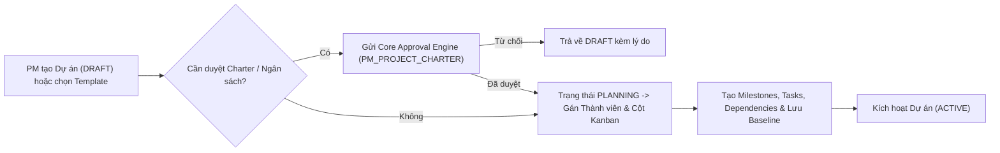
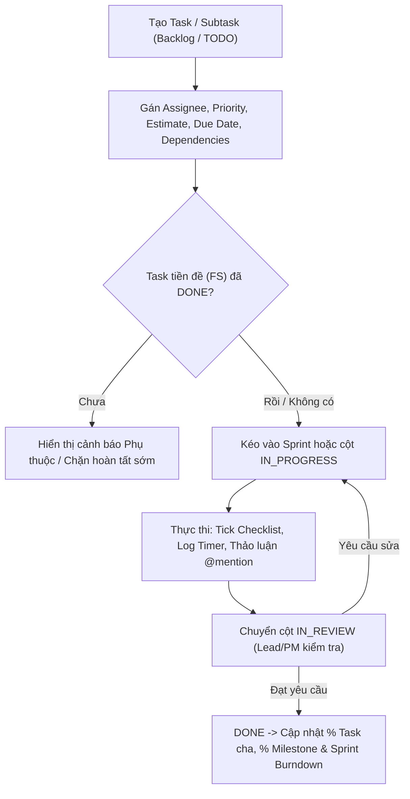
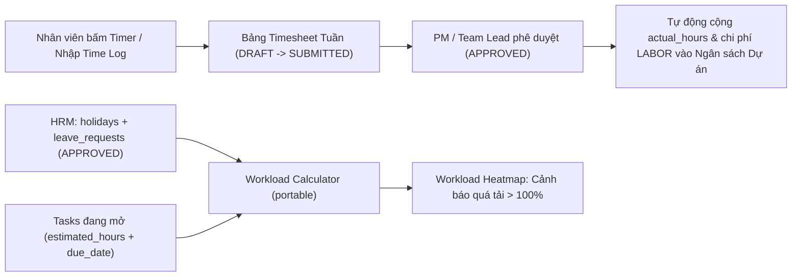
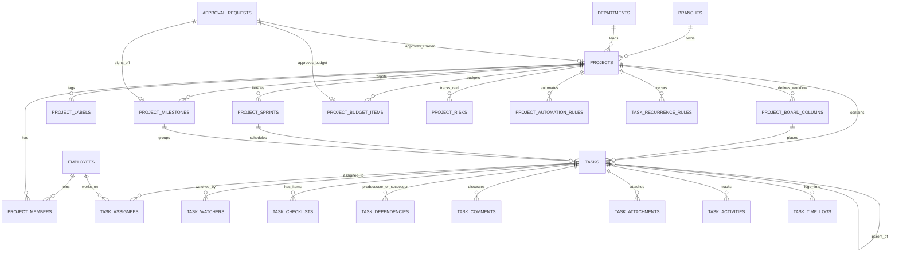

# System Blueprint (Phase 2): Operon Hub — Module Quản lý Dự án & Công việc (`projects`)

> Tài liệu thiết kế kiến trúc tổng thể cho **Giai đoạn 2 (Phase 2)** của hệ thống **Operon Hub**: phân hệ **Quản lý Dự án & Công việc (Project & Task Management — `projects`)**.
> Thiết kế bám sát kiến trúc **Modular Monolith** hiện hữu, tái sử dụng toàn bộ lõi **Core Platform** (`Auth & RBAC`, `Branches`, `Universal Approval Engine`, `Notifications`, `Audit Logs`, `I18n VI/EN`, `Excel/PDF Exporter`) và **tích hợp hai chiều với HRM** (cơ cấu phòng ban, nhân sự, ngày lễ & đơn nghỉ phép đã duyệt để tính chính xác công suất nguồn lực — Workload).

---

## 1. Tổng quan Kiến trúc & Phân quyền 2 Tầng (Actors & RBAC)

### 1.1. Nguyên tắc Tích hợp vào Operon Hub Modular Monolith
- **Định danh Phân hệ:** `code: 'projects'`, `basePath: '/projects'`, prefix API `/api/v1/projects/*`, `/api/v1/tasks/*`, `/api/v1/pm/*`.
- **Đa chi nhánh (Multi-Branch) & Liên phòng ban (Cross-Functional):** Mỗi dự án gắn 1 chi nhánh chủ quản (`branch_id`) và phòng ban chủ trì (`department_id` tùy chọn), nhưng thành viên dự án (`project_members`) có thể tuyển chọn linh hoạt nhân viên từ nhiều phòng ban / chi nhánh khác nhau.
- **Tái sử dụng Động cơ Lõi (Zero Core Duplication):**
  - **Core Approval Engine (`src/modules/approvals/`):** Đăng ký thêm 3 `approval-hooks` mới (`PM_PROJECT_CHARTER`, `PM_MILESTONE_SIGNOFF`, `PM_BUDGET_CHANGE`) và tùy chọn `PM_TIMESHEET` mà không sửa logic lõi của Approval Engine.
  - **Core Notification (`src/modules/notifications/`):** Bắn thông báo in-app khi giao task, `@mention` trong comment, sắp quá hạn, task phụ thuộc bị block, hoặc mốc dự án cần nghiệm thu.
  - **Core Audit Log (`src/modules/audit/`):** Ghi vết thay đổi trạng thái dự án, duyệt/điều chỉnh ngân sách, thay đổi thành viên/vai trò, xóa mềm dự án/task.
  - **Tích hợp HRM (Read-Only Cross-Module Query):** Đọc `employees`, `departments`, `holidays`, và `leave_requests` (`status = 'APPROVED'`) để hiển thị đúng sức chứa công việc thực tế của từng nhân viên trong **Workload Heatmap**.
- **Chính sách Bảo toàn Dữ liệu (No Hard-Delete):** Mọi dự án, cột bảng, sprint, milestone, task, bình luận, timesheet, ngân sách, rủi ro đều **cấm xóa cứng (`DELETE`)** — chỉ sử dụng xóa mềm (`deleted_at`) hoặc chuyển trạng thái `CANCELLED` / `ARCHIVED`.

### 1.2. Mô hình Phân quyền 2 Tầng (System RBAC × Project-Level RBAC)

Để vừa đảm bảo quản trị cấp công ty (Ban Giám đốc / PMO / Trưởng bộ phận) vừa bảo mật dữ liệu từng dự án nhạy cảm (dự án M&A, dự án khách hàng VIP, dự án nội bộ HR/Tài chính), phân hệ áp dụng **2 tầng quyền kết hợp**:

#### Tầng 1: Quyền Hệ thống (`permissions` table — Prefix `pm.*`)

| Mã Permission | Mô tả chức năng |
| :--- | :--- |
| `pm.dashboard.read` | Xem Dashboard tổng quan Danh mục Dự án (theo Data Scope) |
| `pm.projects.read` | Xem danh sách & chi tiết dự án được phép truy cập |
| `pm.projects.create` | Khởi tạo dự án mới (hoặc gửi trình duyệt Project Charter) |
| `pm.projects.manage` | Quản trị toàn diện danh mục dự án (chỉnh sửa, lưu trữ, chuyển PM) |
| `pm.tasks.read` | Xem công việc trong các dự án có quyền truy cập & `/my/tasks` |
| `pm.tasks.create` | Tạo Task, Subtask, Checklist, Dependency |
| `pm.tasks.update` | Cập nhật trạng thái, tiến độ, bình luận, đính kèm |
| `pm.tasks.delete` | Xóa mềm (Archive/Soft-delete) Task trong phạm vi cho phép |
| `pm.sprints.manage` | Tạo, bắt đầu, đóng Sprint & sắp xếp Backlog |
| `pm.timelogs.log` | Ghi nhận giờ công (Manual / Timer) cho task cá nhân |
| `pm.timelogs.approve` | Xem & phê duyệt Timesheet của nhóm/dự án |
| `pm.workload.read` | Xem bản đồ phân bổ nguồn lực (Workload Heatmap) theo Data Scope |
| `pm.budget.read` | Xem ngân sách & chi phí dự án (dữ liệu nhạy cảm) |
| `pm.budget.manage` | Lập ngân sách, ghi nhận chi phí & gửi duyệt thay đổi ngân sách |
| `pm.risks.manage` | Quản trị danh mục Rủi ro & Vấn đề (RAID Register) |
| `pm.templates.manage` | Tạo & quản trị Mẫu Dự án (Project Templates) & Automation Rules |
| `pm.reports.export` | Xuất báo cáo Excel (Task, Timesheet, Portfolio) & PDF Tiến độ Dự án |

#### Tầng 2: Vai trò Cấp Dự án (`project_members.project_role`) & Độ hiển thị (`projects.visibility`)

- **Chế độ hiển thị Dự án (`visibility`):**
  - `PUBLIC_COMPANY`: Mọi nhân viên có `pm.projects.read` đều xem được (chế độ Viewer nếu chưa là thành viên).
  - `BRANCH`: Nhân viên cùng chi nhánh xem được.
  - `DEPARTMENT`: Nhân viên cùng phòng ban chủ trì xem được.
  - `PRIVATE_INVITE`: **Chỉ thành viên trong `project_members`** (và `SUPER_ADMIN` / `EXECUTIVE` nếu bật cờ giám sát) mới nhìn thấy.

- **5 Vai trò trong từng Dự án (`project_role`):**
  1. **`PROJECT_OWNER` (Chủ sở hữu / Sponsor):** Toàn quyền trong dự án, duyệt thay đổi cấu trúc/ngân sách, chuyển giao PM, lưu trữ dự án.
  2. **`PROJECT_MANAGER` (Quản lý Dự án — PM):** Cấu hình cột Kanban/Workflow, quản lý thành viên, tạo/đóng Sprint & Milestone, quản lý ngân sách/rủi ro, cấu hình Automation, xuất báo cáo.
  3. **`TEAM_LEAD` (Trưởng nhóm kỹ thuật / nghiệp vụ):** Tạo/phân công Task, tạo Dependency, quản lý Sprint backlog, duyệt Timesheet & review task (`IN_REVIEW` → `DONE`).
  4. **`MEMBER` (Thành viên thực thi):** Tạo task (nếu dự án cho phép), cập nhật task được giao hoặc tự tạo, kéo-thả cột theo luồng hợp lệ, log thời gian, bình luận, tải file đính kèm.
  5. **`VIEWER` (Người theo dõi / Stakeholder):** Chỉ xem tiến độ, biểu đồ, Gantt, bình luận (nếu bật cờ cho phép comment) — không được sửa task hay log giờ.

### 1.3. Ma trận Phân quyền Mặc định theo Vai trò Hệ thống (Bảo toàn 8 System Roles hiện hữu)

> **Lưu ý kiến trúc:** Giữ nguyên **8 System Roles** cốt lõi trong `database/seed-core.ts` để bảo toàn 100% test `tests/architecture/system-regression-crm-readiness.test.ts`, đồng thời bổ sung thêm role tùy chọn `PMO_MANAGER` (Trưởng ban Quản lý Dự án — `ALL`) trong migration/seed Phase 2.

| Nhóm nghiệp vụ PM | SUPER_ADMIN | EXECUTIVE | PMO_MANAGER *(mới)* | DEPT_MANAGER | HR / ADMIN / PAYROLL | EMPLOYEE |
| :--- | :---: | :---: | :---: | :---: | :---: | :---: |
| Portfolio Dashboard & KPI | R (All) | R (All) | R+E (All) | R (Dept) | R (Own/Branch) | R (Joined) |
| Tạo & Quản trị Dự án | CRUD (All) | R+A (All) | CRUD+E (All) | CRU (Dept) | R (Public/Joined) | R (Public/Joined) |
| Task, Subtask, Kanban, Gantt | CRUD (All) | R (All) | CRUD (All) | CRUD (Dept/Joined) | CRU (Joined) | CRU (Joined/Own) |
| Sprint & Backlog | CRUD (All) | R (All) | CRUD (All) | CRUD (Joined PM/Lead) | R (Joined) | R (Joined) |
| Time Tracking & Timesheet | CRUD+A | R+A | CRUD+A+E | R+A (Dept/Project) | Log (Own) | Log (Own) |
| Workload Heatmap (kết nối HRM) | R (All) | R (All) | R (All) | R (Dept) | R (HR xem toàn công ty) | R (Own) |
| Ngân sách & Chi phí Dự án | CRUD+A | R+A | CRUD+E | R (Project PM) | R (Payroll/Kế toán) | - (Ẩn mặc định) |
| Rủi ro & Vấn đề (RAID) | CRUD | R | CRUD | CRUD (Project) | R (Joined) | CR (Joined) |
| Templates & Automation | CRUD | R | CRUD | CRU (Dept) | - | - |

---

## 2. Danh sách Phân hệ Con (Sub-modules) & Luồng Vận hành (Workflows)

Phân hệ `projects` gồm **8 Sub-modules** hoàn chỉnh đáp ứng từ đội ngũ vận hành đơn giản (Kanban/List) đến đội ngũ phát triển sản phẩm & dự án khách hàng (Scrum Sprint, Gantt CPM, Timesheet, Budget & RAID):

### 2.1. Chi tiết 8 Sub-modules Nghiệp vụ

1. **Sub-module 1 — Quản trị Danh mục Dự án (Project Portfolio & Charter):**
   - Thông tin dự án: Mã dự án duy nhất (`code`, vd `ERP-2026`, tự sinh key công việc `ERP-2026-1`, `ERP-2026-2`... bằng atomic counter `task_seq_counter`), tên, mô tả, phương pháp quản lý (`KANBAN`, `SCRUM`, `WATERFALL`, `HYBRID`), chi nhánh, phòng ban, Sponsor/PM, ngày bắt đầu/kết thúc dự kiến & thực tế, ngân sách dự kiến, mức ưu tiên, trạng thái sức khỏe RAG (`ON_TRACK`, `AT_RISK`, `OFF_TRACK`).
   - Vòng đời dự án: `DRAFT` → `PENDING_APPROVAL` *(tùy chọn qua Core Approval Engine)* → `PLANNING` → `ACTIVE` → `ON_HOLD` → `COMPLETED` / `CANCELLED` → `ARCHIVED`.
   - Quản lý thành viên dự án (`project_members`): vai trò cấp dự án, % phân bổ công suất (`allocation_percent`, 0–100%), chi phí giờ chuẩn nội bộ (`hourly_cost_rate` để tự tính chi phí nhân công từ timesheet).

2. **Sub-module 2 — Công việc, Phân cấp Đa tầng, Workflow Tùy chỉnh & Phụ thuộc (Task Engine):**
   - **Cột Kanban / Workflow tùy chỉnh (`project_board_columns`):** Mỗi dự án khởi tạo bộ cột mặc định (vd: `Backlog`, `Cần làm`, `Đang làm`, `Chờ duyệt`, `Hoàn thành`) nhưng PM có thể thêm/đổi tên/đổi màu/đặt **WIP Limit** (giới hạn số card tối đa trên cột). Mỗi cột ánh xạ về 1 `status_category` chuẩn (`TODO`, `IN_PROGRESS`, `IN_REVIEW`, `BLOCKED`, `DONE`) để báo cáo Portfolio toàn công ty luôn đồng nhất.
   - **Cấu trúc phân cấp:** `Project` → `Phase / Epic (optional)` → `Task` → `Subtask` (tối đa 3 tầng, dùng `wouldCreateCycle` từ `src/lib/portable/tree-utils.ts` chặn vòng lặp cha-con) → `Checklist Items` (hạng mục kiểm tra nhẹ ngay trong task).
   - **Đa người thực hiện & Theo dõi:** `task_assignees` (phân biệt `PRIMARY` và `COLLABORATOR`), `task_watchers` (nhận thông báo khi có thay đổi).
   - **Phụ thuộc Công việc (`task_dependencies`):** Hỗ trợ đủ 4 kiểu chuẩn PMI (`FS`, `SS`, `FF`, `SF`) kèm độ trễ `lag_days` (số ngày cộng/trừ). Tự động kiểm tra chu trình đồ thị (DAG) khi thêm dependency và đánh dấu cờ cảnh báo nếu task tiền đề chưa `DONE`.
   - **Nhãn dán (Labels) & Công việc Lặp định kỳ (`task_recurrence_rules`):** Tạo mẫu lặp hàng ngày/tuần/tháng (vd: "Tổng hợp báo cáo tiến độ thứ 6 hằng tuần").

3. **Sub-module 3 — Quản trị Agile Sprint & Backlog:**
   - Màn hình Backlog tách đôi: danh sách `Backlog` và các `Sprint` (`PLANNED`, `ACTIVE`, `COMPLETED`), hỗ trợ kéo-thả ưu tiên bằng **Fractional Indexing** (`sort_rank`).
   - Nhập Story Points, Sprint Goal, ngày bắt đầu/kết thúc Sprint.
   - **Chốt Sprint (Complete Sprint):** Tính toán tự động số task/story points hoàn thành; cho phép chọn xử lý các task chưa `DONE` (đẩy sang Sprint kế tiếp hoặc trả về Backlog) trong 1 Transaction nguyên tử.
   - **Biểu đồ Agile:** Sprint Burndown Chart (Ideal line vs Actual remaining points/hours) và Sprint Velocity Chart (so sánh Committed vs Completed qua 6 sprint gần nhất).

4. **Sub-module 4 — Mốc Dự án (Milestones), Biểu đồ Gantt & Lịch Công việc (Calendar):**
   - **Milestones (`project_milestones`):** Đánh dấu cột mốc bàn giao quan trọng (vd: "Nghiệm thu UAT", "Go-Live"), gắn danh sách task thuộc mốc, tự tính `% hoàn thành`, hỗ trợ trình ký nghiệm thu mốc qua **Core Approval Engine (`PM_MILESTONE_SIGNOFF`)**.
   - **Gantt Chart tương tác:**
     - Zoom theo Ngày / Tuần / Tháng / Quý; hiển thị thanh Task, Milestone dạng hình thoi, mũi tên Dependency (`FS`/`SS`/`FF`/`SF`).
     - Chế độ bật/tắt **Critical Path (Đường găng CPM)** và **Baseline Comparison** (so sánh `baseline_start_date`/`baseline_due_date` với kế hoạch hiện tại).
     - Kéo giãn thời gian trực tiếp trên thanh Gantt kèm tùy chọn **Auto-Shift** tự động đẩy lịch các task phụ thuộc phía sau.
   - **Project Calendar:** View Tháng/Tuần (kế thừa UX tối ưu đã áp dụng ở Meeting Rooms: chiều cao ô cố định + hiển thị 1–2 task tiêu biểu + nút `+N more` mở Modal xem toàn bộ task trong ngày).

5. **Sub-module 5 — Tương tác, Thảo luận, Tài liệu & Nhật ký Hoạt động (Collaboration):**
   - **Threaded Comments (`task_comments`):** Hỗ trợ trả lời theo luồng (`parent_comment_id`), gắn thẻ `@mention` nhân viên (gửi thông báo tới `notifications`), đánh dấu comment đã giải quyết (`is_resolved`) khi review.
   - **Kho Tài liệu (`task_attachments` & Project Docs):** Đính kèm file vào Task hoặc cấp Dự án (kiểm soát định dạng/dung lượng an toàn, lưu vết người upload, xóa mềm).
   - **Activity Log chi tiết (`task_activities`):** Tự động ghi nhận lịch sử đổi cột, đổi người làm, đổi hạn chót, log giờ, thêm dependency (hiển thị dạng Timeline trong Task Detail Drawer).

6. **Sub-module 6 — Chấm giờ (Time Tracking), Timesheet & Phân bổ Nguồn lực (Workload ↔ HRM):**
   - **Time Tracking (`task_time_logs`):**
     - Bấm **Start/Stop Timer** chạy trên server (`started_at` lưu DB — không mất khi đóng trình duyệt, tự cảnh báo nếu quên tắt quá 12 giờ) hoặc nhập tay theo ngày (`logged_date`, `duration_minutes`, `is_billable`, `description`).
     - Tự động cộng dồn `actual_hours` trên Task và tính chi phí nhân công ước tính dựa trên `hourly_cost_rate`.
   - **Timesheet Tuần & Duyệt giờ:** Nhân viên xem bảng giờ làm theo tuần (hàng = Task, cột = T2..CN), gửi duyệt (`SUBMITTED` → `APPROVED` / `REJECTED`) bởi PM/Lead.
   - **Workload Heatmap tích hợp HRM:**
     - Ma trận **Nhân viên × Tuần/Ngày**, tính công suất chuẩn mỗi ngày từ cấu hình ca làm việc (mặc định 8h/ngày, loại trừ T7/CN, `holidays` và `leave_requests` đã `APPROVED` của HRM).
     - Tô màu trực quan: `< 60%` (Còn tải — Xanh dương nhạt), `60–100%` (Tối ưu — Xanh lá), `> 100%` (Quá tải — Đỏ cam) + cho phép PM click để tái phân bổ task ngay.

7. **Sub-module 7 — Ngân sách Dự án (Budget/Cost) & Quản trị Rủi ro/Vấn đề (RAID):**
   - **Ngân sách & Chi phí (`project_budget_items`):** Quản lý kế hoạch chi tiêu vs chi phí thực tế theo hạng mục (`LABOR`, `VENDOR`, `INFRA`, `LICENSE`, `TRAVEL`, `OTHER`), tự động quy đổi `LABOR` từ Timesheet đã duyệt, tính Burn Rate & Variance (`planned - actual`), trình duyệt bổ sung ngân sách qua Core Approval Engine (`PM_BUDGET_CHANGE`).
   - **Risk & Issue Register (`project_risks`):** Phân loại `RISK` (Rủi ro tiềm ẩn) và `ISSUE` (Vấn đề đã phát sinh), chấm điểm `probability (1..5) × impact (1..5) = severity_score (1..25)`, ma trận nhiệt 5×5, phân công `owner_employee_id`, phương án xử lý (`mitigation_plan`), hỗ trợ nút **"Tạo Task khắc phục"** liên kết trực tiếp `linked_task_id`.

8. **Sub-module 8 — My Work Hub, Project Templates, Automation Rules & Báo cáo Xuất File:**
   - **My Work Hub (`/my/tasks`):** Bảng điều khiển cá nhân trong nhóm `workspace` — nhóm công việc theo `Quá hạn`, `Hôm nay`, `Tuần này`, `Sắp tới`, `Đang theo dõi`; hỗ trợ chuyển trạng thái nhanh & bấm Timer ngay tại dòng.
   - **Project Templates (`project_templates`):** Lưu dự án hiện tại thành Mẫu (gồm cấu trúc cột Kanban, danh sách phase/task khung, checklist, mốc thời gian tương đối `T+N ngày`) để nhân bản dự án mới trong 5 giây.
   - **Project Automation Rules (`project_automation_rules`):** Luật tự động hóa an toàn theo phạm vi dự án:
     - *Khi tất cả Subtask đều `DONE`* → tự động chuyển Task cha sang `IN_REVIEW` hoặc thông báo PM.
     - *Khi Task chuyển sang cột `BLOCKED`* → gửi thông báo khẩn cho PM & Team Lead.
     - *Khi Task quá hạn `due_date < today` và chưa `DONE`* → gắn cảnh báo quá hạn & thông báo Assignee + PM.
   - **Executive Portfolio Dashboard & Export:**
     - KPI toàn công ty/chi nhánh: Tổng dự án theo trạng thái & RAG Health, Tỉ lệ Task hoàn thành đúng hạn, Tổng giờ thực hiện vs ước tính, Ngân sách đã giải ngân vs kế hoạch, Top dự án có rủi ro cao.
     - Xuất **Excel** (`exceljs`): Danh sách Task theo bộ lọc, Bảng Timesheet tổng hợp, Báo cáo Portfolio.
     - Xuất **PDF** (`pdfmake` font tiếng Việt A4): **Báo cáo Tình hình Dự án (Project Status Report)** gồm Tổng quan, Tiến độ Milestone, Danh sách Rủi ro trọng yếu, Ngân sách & Khối lượng công việc.

### 2.2. Các Luồng Vận hành Nghiệp vụ Chính (Mermaid Workflows)

#### Luồng A: Khởi tạo Dự án, Trình duyệt Charter & Lập Kế hoạch


#### Luồng B: Vòng đời Công việc (Task), Phụ thuộc (Dependency) & Sprint


#### Luồng C: Tích hợp Time Tracking ↔ HRM Workload ↔ Ngân sách


---

## 3. Kiến trúc Database Tổng thể (MySQL 8+ — 21 Bảng Nghiệp vụ)

### 3.1. Tuân thủ 100% `database-standards.md`
- **Engine & Charset:** `InnoDB`, `DEFAULT CHARSET=utf8mb4 COLLATE=utf8mb4_unicode_ci`.
- **Naming:** `snake_case`, tên bảng số nhiều, PK `id BIGINT UNSIGNED AUTO_INCREMENT`, FK `fk_<bang>_<cot>`, Index `idx_<bang>_<cot>`, Unique `uq_<bang>_<cot>`.
- **Số học chính xác:** Tiền tệ ngân sách/chi phí/đơn giá dùng `DECIMAL(18,2)`; giờ làm việc/ước tính/story points dùng `DECIMAL(6,2)`; phần trăm tiến độ/phân bổ dùng `TINYINT UNSIGNED` (`0..100`) hoặc `DECIMAL(5,2)`. **Tuyệt đối không dùng `FLOAT`/`DOUBLE`.**
- **Audit & Soft Delete:** Tất cả bảng thực thể chính có `created_by`, `updated_by`, `created_at`, `updated_at`, `deleted_at NULL` (cấm hard-delete).
- **Chống ghi đè đồng thời (Optimistic Locking):** Bảng `tasks` có cột `version INT UNSIGNED NOT NULL DEFAULT 1` để xử lý xung đột khi 2 người kéo-thả/sửa cùng 1 task.

### 3.2. Danh mục 21 Bảng Nghiệp vụ Phân hệ `projects`

| Phân nhóm | Tên bảng | Cột chính, Ràng buộc & Index trọng yếu |
| :--- | :--- | :--- |
| **1. Portfolio & Team** | `projects` | `id`, `code` (UQ `VARCHAR(24)`), `name`, `description`, `branch_id` (FK `branches`), `department_id` (FK `departments` NULL), `owner_employee_id` (FK `employees`), `manager_employee_id` (FK `employees`), `methodology` (`KANBAN`/`SCRUM`/`WATERFALL`/`HYBRID`), `visibility` (`PUBLIC_COMPANY`/`BRANCH`/`DEPARTMENT`/`PRIVATE_INVITE`), `priority` (`LOW`/`MEDIUM`/`HIGH`/`CRITICAL`), `status` (`DRAFT`/`PENDING_APPROVAL`/`PLANNING`/`ACTIVE`/`ON_HOLD`/`COMPLETED`/`CANCELLED`/`ARCHIVED`), `health_status` (`ON_TRACK`/`AT_RISK`/`OFF_TRACK`), `start_date`, `target_end_date`, `actual_end_date`, `baseline_start_date`, `baseline_end_date`, `planned_budget` (`DECIMAL(18,2)`), `actual_cost` (`DECIMAL(18,2)`), `progress_percent` (`DECIMAL(5,2)`), `task_seq_counter` (`INT UNSIGNED DEFAULT 0`), `approval_request_id` (FK NULL), `color_hex`, audit + `deleted_at`. Index `(branch_id, status)`, `(manager_employee_id)` |
| | `project_members` | `id`, `project_id` (FK), `employee_id` (FK), `project_role` (`PROJECT_OWNER`/`PROJECT_MANAGER`/`TEAM_LEAD`/`MEMBER`/`VIEWER`), `allocation_percent` (`TINYINT UNSIGNED DEFAULT 100`), `hourly_cost_rate` (`DECIMAL(18,2) DEFAULT 0`), `joined_at`, `left_at` (NULL), audit + `deleted_at`. UQ `(project_id, employee_id)` |
| | `project_board_columns` | `id`, `project_id` (FK), `code` (`VARCHAR(40)`), `name`, `status_category` (`TODO`/`IN_PROGRESS`/`IN_REVIEW`/`BLOCKED`/`DONE`), `color_hex`, `wip_limit` (`INT UNSIGNED NULL`), `sort_order` (`INT UNSIGNED`), `is_default_initial` (`TINYINT(1)`), `is_done_column` (`TINYINT(1)`), audit + `deleted_at`. UQ `(project_id, code)` |
| | `project_labels` | `id`, `project_id` (FK NULL = global label), `name`, `color_hex`, audit + `deleted_at`. UQ `(project_id, name)` |
| **2. Sprint & Milestone** | `project_sprints` | `id`, `project_id` (FK), `name`, `goal`, `start_date`, `end_date`, `status` (`PLANNED`/`ACTIVE`/`COMPLETED`/`CANCELLED`), `committed_points` (`DECIMAL(6,2)`), `completed_points` (`DECIMAL(6,2)`), `completed_at`, audit + `deleted_at`. Index `(project_id, status)` |
| | `project_milestones` | `id`, `project_id` (FK), `name`, `description`, `due_date`, `completed_at` (NULL), `status` (`UPCOMING`/`IN_PROGRESS`/`PENDING_SIGNOFF`/`COMPLETED`/`DELAYED`/`CANCELLED`), `requires_signoff` (`TINYINT(1)`), `approval_request_id` (FK NULL), `owner_employee_id` (FK NULL), `sort_order`, audit + `deleted_at`. Index `(project_id, due_date)` |
| **3. Task Core** | `tasks` | `id`, `project_id` (FK), `parent_task_id` (FK self NULL), `column_id` (FK `project_board_columns`), `sprint_id` (FK `project_sprints` NULL), `milestone_id` (FK `project_milestones` NULL), `task_key` (UQ `VARCHAR(40)`, vd `PRJ-01-12`), `title`, `description` (`MEDIUMTEXT`), `task_type` (`EPIC`/`TASK`/`BUG`/`FEATURE`/`IMPROVEMENT`), `priority` (`LOW`/`MEDIUM`/`HIGH`/`URGENT`), `status_category` (`TODO`/`IN_PROGRESS`/`IN_REVIEW`/`BLOCKED`/`DONE`), `reporter_employee_id` (FK `employees`), `start_date`, `due_date`, `baseline_start_date`, `baseline_due_date`, `completed_at`, `estimated_hours` (`DECIMAL(6,2)`), `actual_hours` (`DECIMAL(6,2) DEFAULT 0`), `story_points` (`DECIMAL(5,2) NULL`), `progress_percent` (`TINYINT UNSIGNED DEFAULT 0`), `sort_rank` (`VARCHAR(64)` — LexoRank), `is_blocked` (`TINYINT(1)`), `blocked_reason`, `version` (`INT UNSIGNED DEFAULT 1`), audit + `deleted_at`. Index `(project_id, column_id, sort_rank)`, `(project_id, sprint_id)`, `(due_date, status_category)`, `(parent_task_id)` |
| | `task_assignees` | `task_id` (FK), `employee_id` (FK), `assignment_role` (`PRIMARY`/`COLLABORATOR`), `assigned_by`, `assigned_at` — PK `(task_id, employee_id)`. Index `(employee_id)` |
| | `task_watchers` | `task_id` (FK), `employee_id` (FK), `created_at` — PK `(task_id, employee_id)` |
| | `task_label_links` | `task_id` (FK), `label_id` (FK `project_labels`) — PK `(task_id, label_id)` |
| | `task_checklists` | `id`, `task_id` (FK), `title`, `is_completed` (`TINYINT(1)`), `assignee_employee_id` (FK NULL), `due_date` (NULL), `sort_order`, `completed_at`, audit + `deleted_at`. Index `(task_id, sort_order)` |
| | `task_dependencies` | `id`, `project_id` (FK), `predecessor_task_id` (FK `tasks`), `successor_task_id` (FK `tasks`), `dependency_type` (`FS`/`SS`/`FF`/`SF`), `lag_days` (`SMALLINT DEFAULT 0`), `created_by`, `created_at`. UQ `(predecessor_task_id, successor_task_id)` + CHECK `predecessor_task_id <> successor_task_id` |
| **4. Collaboration** | `task_comments` | `id`, `task_id` (FK), `parent_comment_id` (FK self NULL), `author_employee_id` (FK `employees`), `content` (`TEXT`), `mentioned_employee_ids_json` (`JSON`), `is_resolved` (`TINYINT(1) DEFAULT 0`), `edited_at`, audit + `deleted_at`. Index `(task_id, created_at)` |
| | `task_attachments` | `id`, `project_id` (FK), `task_id` (FK NULL — NULL nếu là tài liệu cấp dự án), `uploaded_by_employee_id` (FK), `file_name`, `stored_path`, `mime_type`, `file_size_bytes` (`BIGINT UNSIGNED`), `checksum_sha256`, audit + `deleted_at`. Index `(project_id, task_id)` |
| | `task_activities` | `id`, `project_id` (FK), `task_id` (FK NULL), `actor_user_id` (FK `users`), `action_type` (`CREATED`/`STATUS_CHANGED`/`ASSIGNED`/`DUE_DATE_CHANGED`/`PRIORITY_CHANGED`/`SPRINT_MOVED`/`TIME_LOGGED`/`COMMENTED`/`DEPENDENCY_ADDED`...), `field_name`, `old_value_json`, `new_value_json`, `created_at`. Index `(task_id, created_at)`, `(project_id, created_at)` |
| **5. Time, Budget & RAID** | `task_time_logs` | `id`, `project_id` (FK), `task_id` (FK), `employee_id` (FK), `logged_date` (`DATE`), `started_at` (NULL — dùng cho Live Timer), `ended_at` (NULL), `duration_minutes` (`INT UNSIGNED`), `is_billable` (`TINYINT(1) DEFAULT 1`), `hourly_cost_snapshot` (`DECIMAL(18,2)`), `description`, `approval_status` (`DRAFT`/`SUBMITTED`/`APPROVED`/`REJECTED`), `approved_by_user_id` (FK NULL), `approved_at`, `rejection_reason`, audit + `deleted_at`. Index `(employee_id, logged_date)`, `(project_id, approval_status)`, `(task_id)` |
| | `project_budget_items` | `id`, `project_id` (FK), `category` (`LABOR`/`VENDOR`/`INFRA`/`SOFTWARE`/`TRAVEL`/`OTHER`), `title`, `planned_amount` (`DECIMAL(18,2)`), `actual_amount` (`DECIMAL(18,2) DEFAULT 0`), `incurred_date` (`DATE NULL`), `status` (`PLANNED`/`PENDING_APPROVAL`/`APPROVED`/`SPENT`/`CANCELLED`), `approval_request_id` (FK NULL), `note`, audit + `deleted_at`. Index `(project_id, category)` |
| | `project_risks` | `id`, `project_id` (FK), `code` (`VARCHAR(32)`), `item_type` (`RISK`/`ISSUE`), `title`, `description`, `probability` (`TINYINT UNSIGNED` 1..5), `impact` (`TINYINT UNSIGNED` 1..5), `severity_score` (`TINYINT UNSIGNED`), `status` (`OPEN`/`MITIGATING`/`ESCALATED`/`RESOLVED`/`CLOSED`), `owner_employee_id` (FK NULL), `mitigation_plan` (`TEXT`), `linked_task_id` (FK `tasks` NULL), `identified_date`, `resolved_at`, audit + `deleted_at`. Index `(project_id, status, severity_score)` |
| **6. Templates & Automation** | `project_templates` | `id`, `branch_id` (FK NULL = dùng chung toàn công ty), `code` (UQ), `name`, `description`, `methodology`, `template_payload_json` (`JSON` — cột Kanban, phase, task khung, checklist, offset `T+N`), `is_active`, audit + `deleted_at` |
| | `task_recurrence_rules` | `id`, `project_id` (FK), `template_task_id` (FK `tasks`), `frequency` (`DAILY`/`WEEKLY`/`MONTHLY`), `interval_value` (`TINYINT UNSIGNED DEFAULT 1`), `weekdays_json` (`JSON NULL`), `day_of_month` (`TINYINT UNSIGNED NULL`), `next_run_date` (`DATE`), `end_date` (`DATE NULL`), `is_active`, audit + `deleted_at`. Index `(is_active, next_run_date)` |
| | `project_automation_rules` | `id`, `project_id` (FK), `name`, `trigger_event` (`TASK_MOVED_COLUMN`/`TASK_OVERDUE`/`ALL_SUBTASKS_DONE`/`TASK_ASSIGNED`), `condition_json` (`JSON`), `action_type` (`NOTIFY_PM`/`MOVE_COLUMN`/`SET_BLOCKED`/`ADD_WATCHER`), `action_payload_json` (`JSON`), `is_active`, audit + `deleted_at`. Index `(project_id, trigger_event, is_active)` |

### 3.3. Chuỗi File Migration Dự kiến (Nối tiếp sau `#14`, đầy đủ `UP` & `DOWN`)
1. `database/migrations/20261124_000015_init_pm_projects_members_columns.sql` — `projects`, `project_members`, `project_board_columns`, `project_labels` + seed quyền `pm.*` & role `PMO_MANAGER`.
2. `database/migrations/20261124_000016_init_pm_sprints_milestones_tasks.sql` — `project_sprints`, `project_milestones`, `tasks`, `task_assignees`, `task_watchers`, `task_label_links`, `task_checklists`, `task_dependencies`.
3. `database/migrations/20261124_000017_init_pm_collaboration_activities.sql` — `task_comments`, `task_attachments`, `task_activities`.
4. `database/migrations/20261124_000018_init_pm_timelogs_budget_risks.sql` — `task_time_logs`, `project_budget_items`, `project_risks`.
5. `database/migrations/20261124_000019_init_pm_templates_recurrence_automation.sql` — `project_templates`, `task_recurrence_rules`, `project_automation_rules`.

### 3.4. Sơ đồ Quan hệ Thực thể Tổng quan (ERD — Mermaid)



---

## 4. Danh sách Nhóm API & Sơ đồ Giao diện (Sitemap & Dual-Rail UI)

### 4.1. Kiến trúc API (`/api/v1/projects/*`, `/api/v1/tasks/*`, `/api/v1/pm/*`)
- **Chuẩn Response:** Tái sử dụng `ok`, `created`, `fail`, `AppError`, `withErrorHandler` từ `src/shared/api-response.ts`.
- **Phân quyền 2 lớp Middleware:** `withAuth(handler, { permission })` + helper `assertProjectAccess(auth, projectId, requiredProjectRoles)` kiểm tra đồng thời System RBAC, Data Scope và Project Role/Visibility.
- **Chống Xung đột Kéo-Thả (Optimistic Concurrency):** `PATCH /api/v1/tasks/:id/move` nhận `expectedVersion` (hoặc thực thi `SELECT ... FOR UPDATE` trong transaction) để đảm bảo thứ tự `sort_rank` & kiểm tra `wip_limit` chính xác.

| Nhóm API | Prefix | Endpoints chính |
| :--- | :--- | :--- |
| **Portfolio & Projects** | `/api/v1/projects` | `GET /` (filter branch/dept/status/health/mine), `POST /` (tạo mới hoặc từ `templateId`), `GET /:id`, `PATCH /:id`, `POST /:id/status` (chuyển vòng đời / trình duyệt Charter), `POST /:id/archive` (soft-archive), `DELETE /:id` (`405` hard-delete forbidden hoặc soft-delete tùy policy chuẩn) |
| **Members & Workflow** | `/api/v1/projects/:id/*` | `GET/POST/PATCH/DELETE /members`, `GET/POST/PATCH /columns` (kèm reorder & WIP limit), `GET/POST/PATCH /labels`, `POST /baseline/capture` (chụp mốc baseline cho Gantt) |
| **Sprints & Milestones** | `/api/v1/projects/:id/*` | `GET/POST/PATCH /sprints`, `POST /sprints/:sprintId/start`, `POST /sprints/:sprintId/complete` (kèm carryover), `GET /sprints/:sprintId/burndown`, `GET/POST/PATCH /milestones`, `POST /milestones/:mid/request-signoff` |
| **Tasks & Hierarchy** | `/api/v1/tasks` | `GET /my` (My Work Hub), `GET /` (List/Board/Calendar/Gantt theo `projectId`), `POST /`, `GET /:id` (chi tiết đầy đủ subtasks/checklists/deps/comments/files/activities), `PATCH /:id`, `PATCH /:id/move` (đổi cột/sprint/LexoRank), `POST /:id/archive`, `POST /:id/checklists`, `PATCH /:id/checklists/:cid`, `POST /:id/dependencies`, `DELETE /:id/dependencies/:depId` |
| **Collaboration** | `/api/v1/tasks/:id/*` | `GET/POST /comments`, `PATCH /comments/:cid` (sửa / resolve), `GET/POST /attachments`, `GET /attachments/:aid/download`, `GET /activities` |
| **Time & Workload** | `/api/v1/pm/*` | `POST /timelogs/timer/start`, `POST /timelogs/timer/stop`, `GET/POST/PATCH /timelogs`, `POST /timelogs/submit-week`, `POST /timelogs/approve`, `GET /workload` (ghép `tasks` + HRM `leave_requests` + `holidays`) |
| **Budget & RAID** | `/api/v1/projects/:id/*` | `GET/POST/PATCH /budget-items`, `POST /budget-items/:bid/request-approval`, `GET/POST/PATCH /risks`, `POST /risks/:rid/create-task` |
| **Templates & Rules** | `/api/v1/pm/*` | `GET/POST/PATCH /templates`, `POST /projects/:id/save-as-template`, `GET/POST/PATCH /projects/:id/automations`, `GET/POST/PATCH /projects/:id/recurrences`, `POST /recurrences/run-due` |
| **Dashboard & Export** | `/api/v1/pm/*` | `GET /dashboard/summary`, `GET /projects/:id/gantt` (kèm Critical Path tính sẵn), `GET /reports/tasks/export` (Excel), `GET /reports/timesheets/export` (Excel), `GET /projects/:id/status-report/pdf` (PDF A4 tiếng Việt) |

### 4.2. Sơ đồ Cây Giao diện (Sitemap) & Tích hợp Dual-Rail Portal

Tích hợp mượt vào **Midnight Command Dual-Rail Shell** (`src/layouts/portal-navigation.ts`):
- **Rail `workspace` (Tổng / Home):** Thêm **`/my/tasks`** (`Công việc của tôi` / `My Tasks`) ngay bên dưới `/dashboard` để mọi nhân viên thấy việc cần làm mỗi sáng.
- **Rail mới `projects` (`Dự án` / `Projects`):** Đặt giữa `services` và `hrm` (hiển thị với mọi user có `pm.projects.read` hoặc `pm.tasks.read`).

```text
Operon Hub Portal (Dual-Rail Shell — VI / EN Bilingual)
├── [Rail: workspace]
│   ├── /dashboard                             — Bổ sung widget "Việc cần làm hôm nay" & "Dự án đang tham gia"
│   └── /my/tasks                              — My Work Hub (Quá hạn / Hôm nay / Tuần này / Đang theo dõi + Quick Timer)
├── [Rail: services]                           — Dịch vụ & Đề xuất (đã có)
├── [Rail: projects] (MỚI — Phase 2)           — Quản lý Dự án & Công việc
│   ├── /projects/dashboard                    — Portfolio Dashboard (RAG Health, KPI, Velocity, Budget Burn)
│   ├── /projects                              — Danh mục Dự án (Grid/Table View, lọc Chi nhánh/Phòng ban/RAG/Của tôi)
│   ├── /projects/[code]                       — Không gian làm việc Dự án (8 Tabs thống nhất)
│   │   ├── Tab 1: Overview                    — Thông tin Charter, Tiến độ Milestone, Thành viên, RAG & Hoạt động
│   │   ├── Tab 2: List View                   — Bảng phân cấp Tree Table (Epic → Task → Subtask), sửa inline, lọc đa tiêu chí
│   │   ├── Tab 3: Kanban Board                — Kéo-thả mượt (@dnd-kit), WIP limit badge, nhóm theo Swimlane (Assignee/Priority)
│   │   ├── Tab 4: Backlog & Sprints           — Kế hoạch Sprint, kéo-thả Backlog, Start/Complete Sprint, Burndown & Velocity
│   │   ├── Tab 5: Gantt Timeline              — Biểu đồ Gantt tương tác, mũi tên Dependency, Critical Path (CPM) & Baseline
│   │   ├── Tab 6: Calendar                    — Lịch Tháng/Tuần (ô cố định + "+N more" mở DayTasksModal)
│   │   ├── Tab 7: Time & Budget               — Tổng hợp giờ công, Timesheet dự án, Ngân sách Planned vs Actual
│   │   └── Tab 8: Risks, Docs & Settings      — RAID 5×5 Matrix, Tài liệu dự án, Cấu hình Cột/Labels/Automation
│   ├── /projects/workload                     — Bản đồ Phân bổ Nguồn lực (Workload Heatmap đồng bộ nghỉ phép/lễ HRM)
│   ├── /projects/timesheets                   — Bảng chấm giờ Tuần & Duyệt Timesheet
│   └── /projects/templates                    — Thư viện Mẫu Dự án (Project Templates)
├── [Rail: hrm]                                — Hành chính Nhân sự (giữ nguyên)
├── [Rail: admin]                              — Quản trị Hệ thống (thêm phân quyền pm.* & duyệt Charter/Milestone/Budget)
└── [Rail: crm]                                — Coming Soon
```

### 4.3. Quy chuẩn UI/UX & Song ngữ Bắt buộc
- **View-First Task Detail Drawer:** Click vào bất kỳ Task nào (từ List, Kanban, Sprint, Gantt, Calendar, hay `/my/tasks`) mở **Slide-over Drawer rộng (680–820px)** giữ nguyên ngữ cảnh nền; hiển thị đầy đủ Subtasks, Checklists, Dependencies, Time Logs (kèm nút Start/Stop Timer), Attachments, Threaded Comments (`@mention`), và Activity Timeline.
- **4 Trạng thái UI bắt buộc:** `Loading` (Skeleton đúng hình dạng Board/Table/Gantt + disable submit button chống double-click), `Empty` (CTA tạo dự án/task mẫu), `Error` (thông báo rõ ngữ cảnh + nút Thử lại), `Success` (format ngày `DD/MM/YYYY`, tiền VNĐ `150.000.000 ₫`, giờ `12.5h`, cắt text dài có tooltip).
- **100% Song ngữ `VI / EN`:** Mọi file UI trong `src/app/(portal)/projects/**`, `src/app/(portal)/my/tasks/**`, `src/components/projects/**` đều phải dùng `useI18n()` (`t(...)` hoặc `tr(vi, en)` hoặc `{ vi, en }`) và vượt qua bài test AST `tests/unit/i18n.test.ts` (0 chuỗi tiếng Việt lọt sang bản `EN`).

---

## 5. Đề xuất Công nghệ, Kiểm duyệt MIT & Cấu trúc `src/lib/portable/`

### 5.1. Kiểm duyệt License MIT (Đã xác minh trực tiếp qua `npm registry` ngày 2026-11-24)

| Hạng mục | Package | License thực tế | Trạng thái MIT Policy | Vai trò trong Phase 2 |
| :--- | :--- | :---: | :---: | :--- |
| **Core Stack hiện có** | `next`, `react`, `kysely`, `mysql2`, `zod`, `dayjs`, `recharts`, `exceljs`, `pdfmake`, `@tabler/icons-react`, `vitest` | `MIT` | `[ALREADY INSTALLED]` | Giữ nguyên 100%, không nâng cấp major version |
| **Drag & Drop (Mới)** | `@dnd-kit/core` | `MIT` | `[ALLOWED]` | Kéo-thả Kanban Board, Backlog Sprint & sắp xếp Checklist (hỗ trợ Pointer + Keyboard + Touch) |
| **Sortable (Mới)** | `@dnd-kit/sortable` | `MIT` | `[ALLOWED]` | Kéo-thả đa cột & sắp xếp thứ tự mượt mà |
| **DnD Utilities (Mới)** | `@dnd-kit/utilities` | `MIT` | `[ALLOWED]` | Helper CSS transform nhẹ cho `@dnd-kit` |
| **Từ chối (Tham chiếu)** | `@hello-pangea/dnd` | `Apache-2.0` | **`[REJECTED]`** | **KHÔNG cài** vì vi phạm chính sách MIT-Only |
| **Gantt & Heatmap** | *Tự xây dựng bằng React + Tailwind + `src/lib/portable/gantt-scheduler.ts`* | *Internal (0 deps)* | `[ALLOWED]` | Tránh hoàn toàn các thư viện Gantt thương mại / GPL (như DHTMLX, Bryntum, Frappe) và tùy biến sâu 100% theo Design System Midnight Command |

*(Ghi chú: Trước khi Coder cài `@dnd-kit/*` ở `P2-TASK-03`, chạy hậu kiểm `node .agents/scripts/check-license.js --audit` để bảo đảm 100% package tuân thủ MIT + duy nhất ngoại lệ `typescript` devDep đã được duyệt.)*

### 5.2. Tái sử dụng & Module Mới trong `src/lib/portable/` (Zero Business Coupling)

**Tái sử dụng trực tiếp từ `.agents/rules/reusable-registry.md`:**
- `buildTree`, `wouldCreateCycle`, `collectDescendantIds` (`src/lib/portable/tree-utils.ts`) → Cây Epic/Task/Subtask & chống vòng lặp cha-con.
- `formatDateVN`, `formatDateTimeVN`, `countWorkingDays` (`src/lib/portable/date-utils.ts`) → Tính số ngày làm việc của Task & Gantt.
- `roundCurrency`, `formatVND`, `parseCurrencyInput` (`src/lib/portable/currency-utils.ts`) → Ngân sách & chi phí dự án.
- `parsePaginationParams`, `buildPaginationMeta` (`src/lib/portable/pagination.ts`) → Phân trang danh sách dự án/task/timesheet.
- `buildExcelBuffer` (`src/lib/portable/excel-exporter.ts`) & `generatePdfBuffer` (`src/lib/portable/pdf-generator.ts`) → Xuất báo cáo Excel & PDF Status Report.
- `evaluateWorkflowConditions`, `computeApprovalTransition` (`src/lib/portable/approval-engine.ts`) → Trình duyệt Charter / Milestone / Budget.

**4 Module `src/lib/portable/` MỚI cần tạo (đạt đủ 5 tiêu chí Cross-Project & cập nhật `reusable-registry.md`):**

| File mới | Dependencies | Chức năng cốt lõi (Pure Functions) |
| :--- | :---: | :--- |
| `src/lib/portable/fractional-rank.ts` | `None` | Thuật toán LexoRank / Fractional Indexing (`rankBetween(prev, next)`, `generateInitialRanks(n)`) cho phép kéo-thả Kanban/Backlog chỉ cập nhật đúng **1 bản ghi DB** ($O(1)$) |
| `src/lib/portable/gantt-scheduler.ts` | `None` | Kiểm tra chu trình đồ thị phụ thuộc (`wouldCreateDependencyCycle`), sắp xếp topo, tính **Critical Path Method (CPM)** (Early/Late Start-Finish, Slack = 0), và tính dịch chuyển ngày `autoShiftDependents` cho 4 kiểu `FS`/`SS`/`FF`/`SF` |
| `src/lib/portable/agile-metrics.ts` | `None` | Tính đường Burndown chuẩn vs thực tế (`computeBurndownSeries`), Sprint Velocity, và chỉ số giá trị thu được cơ bản (`computeProjectEvm`: Schedule Variance, Cost Variance, Burn Rate) |
| `src/lib/portable/workload-calculator.ts` | `dayjs` (MIT) | Phân bổ giờ ước tính của task đều qua các ngày làm việc, trừ ngày cuối tuần/ngày lễ/ngày nghỉ phép để tính `allocatedHours`, `capacityHours`, và `utilizationPercent` cho từng nhân sự |

### 5.3. Cấu trúc Thư mục Đề xuất cho Phân hệ `projects`

```text
src/
├── lib/portable/
│   ├── fractional-rank.ts
│   ├── gantt-scheduler.ts
│   ├── agile-metrics.ts
│   └── workload-calculator.ts
├── modules/projects/
│   ├── projects.constants.ts        # Enums, trạng thái, RAG thresholds, default columns
│   ├── projects.access.ts           # Helper assertProjectAccess (System RBAC + Project Role + Visibility)
│   ├── projects.schema.ts           # Zod schemas
│   ├── projects.service.ts          # Portfolio, Members, Board Columns, Labels, Approval Hooks
│   ├── tasks.service.ts             # Task CRUD, Subtasks, Checklists, Dependencies, LexoRank Move
│   ├── sprints.service.ts           # Backlog, Sprint lifecycle, Burndown/Velocity
│   ├── milestones.service.ts        # Milestones, Gantt payload (CPM) & Baseline capture
│   ├── collaboration.service.ts     # Comments (@mention), Attachments, Activity Feed
│   ├── timelogs.service.ts          # Timer Start/Stop, Manual Logs, Weekly Timesheet Approval
│   ├── workload.service.ts          # Tích hợp HRM holidays + leave_requests + tasks
│   ├── budget-risks.service.ts      # Ngân sách, Chi phí, RAID Register & Convert Issue → Task
│   ├── templates-automation.service.ts # Project Templates, Recurrence Runner & Automation Engine
│   └── reports.service.ts           # Portfolio Dashboard KPI, Excel & PDF Status Report
├── components/projects/             # Modular UI components (100% VI/EN)
│   ├── ProjectFormModal.tsx
│   ├── TaskDetailDrawer.tsx         # View-first Slide-over Drawer (Subtasks, Checklists, Deps, Timer, Comments)
│   ├── ProjectKanbanBoard.tsx       # @dnd-kit Kanban + WIP Limit + Swimlanes
│   ├── ProjectListView.tsx          # Hierarchical Tree Table + Inline Quick Edit
│   ├── ProjectSprintBoard.tsx       # Backlog + Sprint + Burndown/Velocity Charts
│   ├── ProjectGanttChart.tsx        # Interactive Gantt + Dependency Arrows + CPM + Baseline
│   ├── ProjectCalendarView.tsx      # Compact Month/Week + DayTasksModal
│   ├── WorkloadHeatmap.tsx          # Resource Matrix tích hợp HRM
│   ├── ProjectBudgetRisksPanel.tsx  # Budget Variance + RAID 5×5 Matrix
│   └── QuickTimerWidget.tsx         # Global Floating/Header Active Timer
└── app/
    ├── (portal)/my/tasks/page.tsx
    ├── (portal)/projects/
    │   ├── dashboard/page.tsx
    │   ├── page.tsx
    │   ├── [code]/page.tsx
    │   ├── workload/page.tsx
    │   ├── timesheets/page.tsx
    │   └── templates/page.tsx
    └── api/v1/
        ├── projects/**
        ├── tasks/**
        └── pm/**
```

---

## 6. Lộ trình Chia nhỏ thành 12 Task Thực thi (Phase 2 Execution Roadmap)

Mỗi Task dưới đây được tách rạch ròi về `DB / API / UI / Portable` để chạy độc lập qua đủ vòng đời **6 Phases** (`Planner Spec → Gate 1 → Coder → Reviewer → Tester → Excel Sync`).

### Đợt 2A — Nền tảng Dự án, Công việc & Kanban/List (MVP Sử dụng được ngay)

| Mã Task | Tên Task | Phạm vi chính (`DB`, `API`, `UI`, `Portable`) | Phụ thuộc | Lưu ý Regression |
| :--- | :--- | :--- | :---: | :--- |
| **`P2-TASK-01`** | **Khung Module `projects`, RBAC 2 tầng, Danh mục Dự án & Điều hướng Dual-Rail** | Migration `#15` (`projects`, `project_members`, `project_board_columns`, `project_labels`, seed quyền `pm.*` + role `PMO_MANAGER`); Đăng ký module `projects` trong `registry.ts` & Rail `projects` trong `portal-navigation.ts`; Hook duyệt `PM_PROJECT_CHARTER`; API CRUD Dự án/Thành viên/Cột/Labels; UI `/projects` (Danh mục Dự án) & Tab `Overview` | Core + HRM | Cập nhật đồng bộ `tests/architecture/system-regression-crm-readiness.test.ts` và `tests/unit/portal-shell-navigation.test.ts` |
| **`P2-TASK-02`** | **Task Core Engine, Subtasks, Checklists, Dependencies & List View** | Migration `#16` (`project_sprints`, `project_milestones`, `tasks`, `task_assignees`, `task_watchers`, `task_label_links`, `task_checklists`, `task_dependencies`); Portable `fractional-rank.ts`; API CRUD Task/Subtask (chặn cycle)/Checklist/Dependency (chặn DAG cycle); UI Tab `List View` (Tree Table) + **View-first `TaskDetailDrawer`** | `P2-TASK-01` | Bảo toàn `tree-utils.ts` & AST i18n audit |
| **`P2-TASK-03`** | **Kanban Board Kéo-Thả (`@dnd-kit`), WIP Limits, Swimlanes & Calendar View** | Cài 3 gói MIT (`@dnd-kit/core`, `@dnd-kit/sortable`, `@dnd-kit/utilities`) + `--audit`; API `PATCH /tasks/:id/move` (optimistic locking `version` + WIP warning); UI Tab `Kanban Board` (kéo-thả cột/card, nhóm Swimlane theo Assignee/Priority) + Tab `Calendar` (ô cố định + `DayTasksModal`) | `P2-TASK-02` | Chạy `check-license.js --audit` xác nhận 100% MIT |
| **`P2-TASK-04`** | **My Work Hub (`/my/tasks`) & Tích hợp Trang chủ Dashboard** | API `GET /api/v1/tasks/my` (nhóm Quá hạn/Hôm nay/Tuần này/Đang theo dõi); Thêm `/my/tasks` vào Rail `workspace`; UI `/my/tasks` thao tác nhanh + Widget "Công việc của tôi" trên `/dashboard` | `P2-TASK-02` | Kiểm tra không làm chậm `/dashboard` hiện hữu |

### Đợt 2B — Agile Sprint, Gantt CPM & Cộng tác Nhóm (Full Project Management)

| Mã Task | Tên Task | Phạm vi chính (`DB`, `API`, `UI`, `Portable`) | Phụ thuộc | Lưu ý Regression |
| :--- | :--- | :--- | :---: | :--- |
| **`P2-TASK-05`** | **Collaboration Suite: Comments `@mention`, File Attachments & Activity Timeline** | Migration `#17` (`task_comments`, `task_attachments`, `task_activities`); Tự động ghi Activity Feed khi sửa Task; Bắn thông báo `@mention` vào Core `notifications`; Upload/Download tài liệu an toàn (MIME/size check, xóa mềm); UI Comments/Files/Timeline trong `TaskDetailDrawer` & Tab Docs | `P2-TASK-02` | Không ảnh hưởng `notifications.service.ts` |
| **`P2-TASK-06`** | **Agile Backlog, Quản trị Sprint & Biểu đồ Burndown / Velocity** | Portable `agile-metrics.ts`; API CRUD Sprint, Start/Complete Sprint (chuyển task chưa xong trong Transaction), API Burndown & Velocity; UI Tab `Backlog & Sprints` (kéo-thả Backlog ↔ Sprint) + Biểu đồ `recharts` | `P2-TASK-03` | Kiểm tra tính nguyên tử khi đóng Sprint |
| **`P2-TASK-07`** | **Milestones, Biểu đồ Gantt Tương tác, Đường găng (CPM) & Baseline** | Portable `gantt-scheduler.ts` (CPM + Auto-Shift 4 loại `FS/SS/FF/SF`); Hook duyệt nghiệm thu mốc `PM_MILESTONE_SIGNOFF`; API Milestones, Capture Baseline, Gantt Data; UI Tab `Gantt Timeline` (Zoom Ngày/Tuần/Tháng, mũi tên Dependency, highlight Critical Path, thanh Baseline) | `P2-TASK-02` | Verify hiệu năng render Gantt với ≥ 200 tasks |

### Đợt 2C — Chấm giờ, Nguồn lực HRM, Ngân sách, Rủi ro, Tự động hóa & Báo cáo Lãnh đạo

| Mã Task | Tên Task | Phạm vi chính (`DB`, `API`, `UI`, `Portable`) | Phụ thuộc | Lưu ý Regression |
| :--- | :--- | :--- | :---: | :--- |
| **`P2-TASK-08`** | **Time Tracking (Live Timer + Manual) & Duyệt Timesheet Tuần** | Migration `#18` (`task_time_logs`, `project_budget_items`, `project_risks`); API Start/Stop Timer server-side, Manual Time Log, Submit & Approve Weekly Timesheet; UI `QuickTimerWidget` trên Topbar/Drawer + `/projects/timesheets` (lưới T2..CN) | `P2-TASK-02` | Không thay đổi schema chấm công HRM (`attendance_logs`) |
| **`P2-TASK-09`** | **Bản đồ Phân bổ Nguồn lực (Workload Heatmap — Tích hợp Nghỉ phép & Ngày lễ HRM)** | Portable `workload-calculator.ts`; API `GET /api/v1/pm/workload` kết hợp `tasks` + `project_members` + HRM `holidays` & `leave_requests` (`APPROVED`); UI `/projects/workload` Heatmap màu sắc + tái phân bổ nhanh | `P2-TASK-08` | Chỉ đọc (read-only) bảng HRM, không tác động logic HRM |
| **`P2-TASK-10`** | **Quản trị Ngân sách Dự án (Budget/Cost) & Rủi ro/Vấn đề (RAID Register)** | Hook duyệt `PM_BUDGET_CHANGE`; API Budget Items (tự đồng bộ chi phí `LABOR` từ Timesheet `APPROVED`), RAID CRUD & 1-click chuyển Issue thành Action Task; UI Tab `Time & Budget` + Tab `Risks` (Ma trận 5×5) | `P2-TASK-08` | Bảo đảm toàn bộ phép tính tiền tệ dùng `DECIMAL(18,2)` |
| **`P2-TASK-11`** | **Thư viện Mẫu Dự án (Templates), Công việc Lặp (Recurring) & Automation Rules** | Migration `#19` (`project_templates`, `task_recurrence_rules`, `project_automation_rules`); API Save-as-Template, Clone Dự án từ Template (dịch ngày `T+N`), Trigger Automation Engine, Recurrence Runner; UI `/projects/templates` & Tab `Settings/Automation` | `P2-TASK-03`, `P2-TASK-07` | Kiểm soát chống vòng lặp vô hạn Automation (max depth = 1) |
| **`P2-TASK-12`** | **Portfolio Dashboard Lãnh đạo, Xuất Báo cáo Excel/PDF & Hồi quy Toàn hệ thống Phase 2** | API Portfolio Dashboard KPI (RAG Health, On-time Delivery, Burn Rate, Risk Hotspots); Xuất Excel (Tasks, Timesheets, Portfolio) bằng `exceljs` + Xuất **PDF Project Status Report** tiếng Việt khổ A4 bằng `pdfmake`; UI `/projects/dashboard`; Chạy full test suite, AST VI/EN audit & đồng bộ `master-testcases.xlsx` | `P2-TASK-06..11` | Pass 100% toàn bộ test Core + HRM + Projects + i18n + MIT Audit |

---

## 7. Tiêu chí Nghiệm thu Tổng thể Phase 2 (Definition of Done)

1. **Đầy đủ nghiệp vụ:** Vận hành trơn tru từ khởi tạo dự án (Charter/Template) → lập kế hoạch (WBS/Kanban/Sprint/Gantt CPM) → thực thi & tương tác (Subtasks, Dependencies, Comments `@mention`, Attachments, Timer) → kiểm soát (HRM Workload, Budget/Cost, RAID Risks) → báo cáo (Portfolio Dashboard, Excel & PDF tiếng Việt).
2. **Bảo mật & Toàn vẹn Dữ liệu:** Kiểm soát chặt RBAC 2 tầng (System + Project Role/Visibility), **0 thao tác hard-delete**, chống race-condition khi kéo-thả/chốt Sprint bằng Transaction & Optimistic Locking.
3. **Chất lượng Kỹ thuật & Song ngữ:** `tsc --noEmit` (0 lỗi), `eslint .` (0 lỗi/0 cảnh báo), `next build` PASS, AST Bilingual Audit `tests/unit/i18n.test.ts` (0 chuỗi VI lọt sang EN), và `check-license.js --audit` đạt 100% MIT (chỉ giữ ngoại lệ `typescript` devDep đã duyệt).
4. **Hồi quy Zero-Regression:** Toàn bộ test Core + HRM + Workplace Services hiện hữu tiếp tục PASS 100%.
