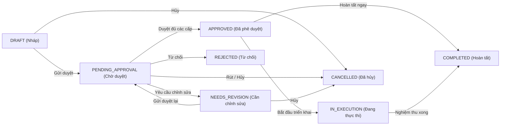
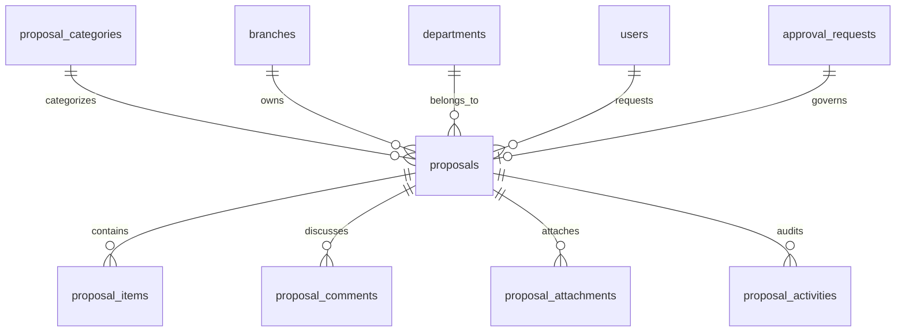

# System Blueprint: Operon Hub — Module Đề xuất Nội bộ (`proposals`)

> Tài liệu thiết kế kiến trúc tổng thể cho phân hệ **Đề xuất Nội bộ (Internal Proposals — `proposals`)** nằm trong nhóm **Trung tâm Dịch vụ Nhân viên (`/services/proposals`)**, tích hợp trực tiếp với **Core Approval Engine**, **Multi-Branch & RBAC Data Scope**, **Notifications**, **Audit Logs**, và **Excel/PDF Exporter**.

---

## 1. Tổng quan & Phân quyền (Actors & RBAC)

### 1.1. Vai trò & Quyền hạn (`permissions` prefix `proposals.*`)

| Mã Permission | Tên tiếng Việt | English Name | Vai trò mặc định |
| :--- | :--- | :--- | :--- |
| `proposals.read` | Xem đề xuất nội bộ trong phạm vi | View internal proposals within scope | Tất cả vai trò (`SUPER_ADMIN`, `EXECUTIVE`, `HR_MANAGER`, `HR_STAFF`, `PAYROLL_ACCOUNTANT`, `ADMIN_OPS`, `DEPT_MANAGER`, `PMO_MANAGER`, `EMPLOYEE`) |
| `proposals.create` | Tạo, sửa nháp và gửi duyệt đề xuất nội bộ | Create, edit draft & submit internal proposals | Tất cả vai trò |
| `proposals.manage` | Quản trị đề xuất, thực thi và danh mục đề xuất | Manage all proposals, execution tracking & categories | `SUPER_ADMIN`, `EXECUTIVE`, `ADMIN_OPS`, `HR_MANAGER`, `PMO_MANAGER` |
| `proposals.export` | Xuất báo cáo đề xuất Excel & tờ trình PDF | Export proposal reports to Excel & PDF | Tất cả vai trò (theo phạm vi dữ liệu được phép xem) |

### 1.2. Phạm vi Dữ liệu (Data Scope)
- `ALL` (`SUPER_ADMIN`, `EXECUTIVE`, `HR_MANAGER`, `PMO_MANAGER`, `PAYROLL_ACCOUNTANT`): xem toàn bộ đề xuất mọi chi nhánh.
- `BRANCH` (`ADMIN_OPS`, `HR_STAFF`): xem đề xuất thuộc chi nhánh được phân công + đề xuất do mình tạo hoặc đang chờ mình duyệt.
- `DEPARTMENT` (`DEPT_MANAGER`): xem đề xuất thuộc phòng ban mình quản lý (bao gồm phòng ban con) + đề xuất do mình tạo hoặc đang chờ mình duyệt.
- `OWN` (`EMPLOYEE`): xem đề xuất do mình tạo + đề xuất mà mình được chỉ định làm người duyệt.

---

## 2. Phân hệ & Luồng Vận hành (Workflows & Lifecycle)

### Tích hợp Core Approval Engine (2 tầng định tuyến theo giá trị)
- **Entity Type:** `proposals` (đăng ký hook `handleProposalApprovalCompletion` trong `src/modules/approvals/register-module-hooks.ts`).
- **Tầng định tuyến ngân sách (`evalContext: { amount: estimatedBudget }`):**
  1. **Đề xuất Giá trị lớn (`>= 20.000.000 ₫`):** Quy trình 3 cấp: `Quản lý trực tiếp / Trưởng bộ phận` → `Hành chính Văn phòng (ADMIN_OPS)` → `Ban Giám đốc (EXECUTIVE)`.
  2. **Đề xuất Tiêu chuẩn (`< 20.000.000 ₫` hoặc không phát sinh ngân sách):** Quy trình 2 cấp: `Quản lý trực tiếp / Trưởng bộ phận` → `Hành chính Văn phòng (ADMIN_OPS)`.
- **Đồng bộ 2 chiều:** Duyệt/Từ chối/Hủy từ `/approvals` hoặc trực tiếp từ trang chi tiết `/services/proposals/[id]` đều đi qua `actOnApprovalRequest` trong transaction để cập nhật đồng bộ `proposals.status`, `approved_at`, `approved_budget`, `rejection_reason`, ghi `proposal_activities` và bắn `notifications`.

---

## 3. Kiến trúc Database (`database/migrations/20261125_000021_init_proposals_module.sql`)

6 bảng chuẩn `InnoDB`, `utf8mb4_unicode_ci`, `snake_case`, không xóa cứng (`deleted_at`):
1. `proposal_categories` — Danh mục loại đề xuất song ngữ (`name`, `name_en`, `code`, `default_request_type`, `requires_budget`, `budget_threshold_high`, `color_hex`, `sort_order`, `is_active`).
2. `proposals` — Hồ sơ đề xuất chính (`proposal_code`, `title`, `summary`, `content`, `expected_outcome`, `priority`, `status`, `estimated_budget DECIMAL(18,2)`, `approved_budget DECIMAL(18,2)`, `needed_by_date`, `vendor_name`, `approval_request_id`...).
3. `proposal_items` — Bảng dự toán chi tiết từng hạng mục (`item_name`, `specification`, `unit`, `quantity`, `unit_price DECIMAL(18,2)`, `line_total DECIMAL(18,2)`, `vendor_note`).
4. `proposal_comments` — Trao đổi thảo luận & ghi chú yêu cầu chỉnh sửa (`comment_type`, `content`).
5. `proposal_attachments` — Tệp đính kèm báo giá / tài liệu kỹ thuật lưu an toàn tại `uploads/proposals/` có SHA-256 checksum.
6. `proposal_activities` — Nhật ký vòng đời bất biến của đề xuất.

---

## 4. Nhóm API & Màn hình UI

### Nhóm API (`/api/v1/proposals/*`)
- `GET / POST /api/v1/proposals` — Danh sách phân trang + lọc đa tiêu chí + tạo mới (lưu nháp hoặc gửi duyệt ngay).
- `GET /api/v1/proposals/summary` — KPI tổng hợp (theo trạng thái, chờ tôi duyệt, tổng ngân sách đề xuất & đã duyệt).
- `GET / PATCH / DELETE /api/v1/proposals/[id]` — Chi tiết đầy đủ + cập nhật nháp/cần sửa + xóa mềm.
- `POST /api/v1/proposals/[id]/submit` — Gửi phê duyệt / gửi duyệt lại qua Core Approval Engine.
- `POST /api/v1/proposals/[id]/status` — Chuyển trạng thái (`REQUEST_REVISION`, `CANCEL`, `START_EXECUTION`, `COMPLETE`).
- `GET / POST /api/v1/proposals/[id]/comments` — Bình luận & trao đổi nội bộ.
- `GET / POST /api/v1/proposals/[id]/attachments` & `GET / DELETE /api/v1/proposals/[id]/attachments/[attachmentId]` — Tải lên / tải xuống / gỡ tệp đính kèm.
- `GET / POST /api/v1/proposals/categories` & `PATCH / DELETE /api/v1/proposals/categories/[id]` — Quản trị danh mục loại đề xuất song ngữ.
- `GET /api/v1/proposals/export/excel` — Xuất Excel `.xlsx` danh sách đề xuất theo bộ lọc.
- `GET /api/v1/proposals/[id]/pdf` — Xuất Tờ trình Đề xuất khổ A4 PDF chuẩn tiếng Việt kèm bảng dự toán & chữ ký duyệt.

### Sơ đồ Giao diện (Sitemap)
- `/services` — Nâng cấp thẻ **Đề xuất Nội bộ** sang trạng thái `ACTIVE`.
- `/services/proposals` — Không gian quản lý Đề xuất (KPI Hero, 4 tabs: Tất cả / Của tôi / Chờ tôi duyệt / Danh mục, Bộ lọc, Tạo/Sửa đề xuất kèm bảng dự toán động, Xuất Excel).
- `/services/proposals/[id]` — Hồ sơ chi tiết đề xuất 2 cột (Nội dung & Dự toán, Đính kèm, Thảo luận, Hộp Phê duyệt trực tiếp + Timeline bước duyệt + Vòng đời thực thi + Xuất PDF).
- `/settings/workflows` & `/approvals` — Hỗ trợ phân hệ `proposals` và liên kết nhanh từ Hộp thư Phê duyệt mở thẳng hồ sơ đề xuất.

---

## 5. Tái sử dụng (`src/lib/portable/`) & Package MIT
- **Tạo mới portable (Zero Business Coupling):** `src/lib/portable/proposal-calculator.ts` (`calculateProposalLineTotals`, `canTransitionProposalStatus`, `formatProposalCode`).
- **Tái sử dụng có sẵn:** `formatVND`, `roundCurrency`, `formatDateVN`, `formatDateTimeVN`, `parsePaginationParams`, `buildPaginationMeta`, `buildExcelBuffer`, `buildStructuredPdfDocument`, `generatePdfBuffer`, `pickLocalizedText`, `evaluateWorkflowConditions`, `computeApprovalTransition`.
- **Package mới:** Không cần cài thêm bất kỳ thư viện nào (100% tuân thủ MIT Policy).

---

## 6. Lộ trình Thực thi (Roadmap)
- `TASK-20261125-01`: Triển khai hoàn chỉnh Module Đề xuất Nội bộ (DB Migration + Seed + Portable Helper + Approval Hook + Backend APIs + Excel/PDF Export + Bilingual UI + Unit & Integration Tests + Seed Sample Data).
