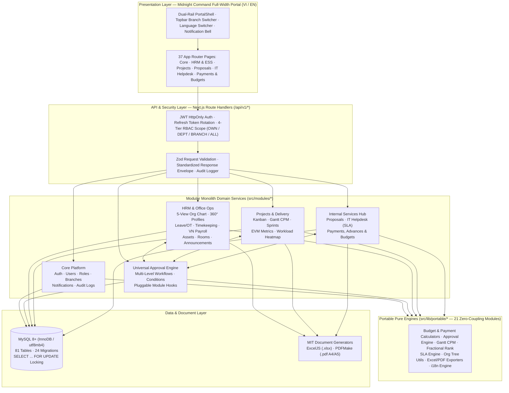
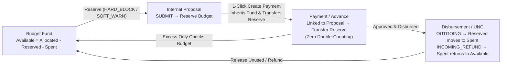

<div align="center">

# Operon Hub

### Modular Enterprise Operations Portal for SMEs

*One unified full-width workspace connecting **Core Governance**, **HRM & Payroll**, **Projects & Agile Delivery**, **Internal Proposals**, **IT Helpdesk**, and **Payments & Budget Accounting** — built on a clean Modular Monolith architecture.*

<br />

[-0f172a?style=for-the-badge)](./README.md)
[](./README.vi.md)

<br />

[](./LICENSE)
[](https://nextjs.org/)
[](https://react.dev/)
[](https://www.typescriptlang.org/)
[](https://www.mysql.com/)
[](#4-engineering-standards--portable-engines)
[-059669.svg)](#8-testing--quality-assurance)

[Overview](#1-overview) · [Architecture](#2-system-architecture) · [Modules](#3-module-matrix--capabilities) · [Engineering](#4-engineering-standards--portable-engines) · [Quick Start](#6-quick-start-local-development) · [Commands](#7-available-scripts) · [Testing](#8-testing--quality-assurance)

</div>

---

## 1. Overview

**Operon Hub** is a **Single-Tenant, Multi-Branch Enterprise Operations Portal** designed for growing SMEs that want integrated workflows without stitching together fragmented SaaS tools.

Built with **Next.js 16 (App Router)**, **React 19**, **TypeScript 5.8**, **Kysely**, and **MySQL 8+**, the platform follows a strict **Modular Monolith** design: core infrastructure (Auth, RBAC, Multi-Branch Isolation, Universal Multi-Level Approvals, Notifications, Audit Logs, Bilingual i18n) powers independent business domains that plug in cleanly without modifying core code.

### Platform Snapshot

| Dimension | Current Scale |
| :--- | :--- |
| **Database Schema** | `24` reversible SQL migrations (`UP`/`DOWN`) · `81` MySQL 8+ tables (`InnoDB`, `utf8mb4_unicode_ci`) |
| **REST API Layer** | `221` typed Route Handlers under `/api/v1/*` with Zod validation & standardized envelopes |
| **Portal Interface** | `37` full-width pages (`Midnight Command` Dual-Rail UI) · Responsive & 100% VI/EN Bilingual |
| **Domain Modules** | `12` decoupled backend modules (`auth`, `users`, `roles`, `branches`, `approvals`, `audit`, `notifications`, `hrm`, `projects`, `proposals`, `it-requests`, `payments`) |
| **Portable Pure Engines** | `21` zero-coupling cross-project modules in `src/lib/portable/` (finance, budget, CPM Gantt, LexoRank, SLA, i18n, PDF/Excel) |
| **Automated Verification** | `78` Vitest suites · `231` automated tests · `131` tracked Master Test Cases |
| **Dependency Policy** | `100%` MIT-licensed production dependencies verified by automated license auditor |

---

## 2. System Architecture



### Cross-Module Budget & Payment Encumbrance Flow

Proposals, Payments, Cash Advances, and Budgets share an **atomic, row-locked encumbrance ledger** (`payment_budgets` + immutable `payment_budget_transactions`) designed to prevent **double-counting** and overspending:



---

## 3. Module Matrix & Capabilities

| Module | Route(s) | Status | Key Capabilities |
| :--- | :--- | :---: | :--- |
| **Core Platform & RBAC** | `/dashboard`, `/settings/*`, `/approvals` | **Ready** | JWT HttpOnly + Refresh Rotation, granular RBAC with 4 data scopes (`OWN`, `DEPARTMENT`, `BRANCH`, `ALL`), Multi-Branch filtering, Universal Multi-Level Approval Engine, Real-time Notifications, Audit Logs, VI/EN Language Switcher |
| **HRM — Organization & People** | `/hrm/organization`, `/hrm/employees`, `/my/*` | **Ready** | **5-View Interactive Org Chart** (Vertical Tree, Horizontal Tree, Matrix Cards, Directory, Table) with headcount rollup & department drawer; 360° Employee Profiles; Employee Self-Service (`/my/profile`, `/my/attendance`, `/my/requests`); Contracts & expiry alerts (`≤ 15d`, `≤ 30d`, overdue); Career history |
| **HRM — Time, Leave & Payroll** | `/hrm/requests`, `/hrm/attendance`, `/hrm/payroll` | **Ready** | Leave balances with seniority accrual, weekend/holiday exclusion, overlap prevention, OT multipliers (`150%` / `200%` / `300%`), Web Check-in/out, Excel timesheet import/export, lockable monthly periods, **Vietnam 7-Tier Progressive PIT Payroll**, social insurance caps, Excel payroll & A4/A5 Vietnamese PDF payslips |
| **HRM — Office Operations** | `/hrm/office` | **Ready** | Asset inventory & atomic allocation/return (`FOR UPDATE` concurrency guard, handover PDF, offboarding unreturned alerts); Smart Meeting Room Booking (4 statuses, no hard-delete, anti-past guard, live availability & month view); Internal Announcements with per-employee read receipts |
| **Projects & Task Delivery** | `/projects`, `/projects/[id]` | **Ready** | Drag-and-drop Kanban with `O(1)` Fractional Indexing (LexoRank), Interactive Gantt Chart with **CPM Critical Path** & dependency auto-shifting (`FS`/`SS`/`FF`/`SF`), Agile Sprints with Burndown & Velocity, **EVM / Burn Rate** tracking, Resource Workload Heatmap (excluding weekends, holidays & approved leave), PDF & Excel reports |
| **Services — Internal Proposals** | `/services/proposals` | **Ready** | Structured itemized cost estimation, Budget fund allocation & live impact preview, Multi-level approval routing, strict collaboration & attachment lock on `PENDING_APPROVAL`, 1-click **"Create Payment Request"** from approved proposals, executive A4 PDF & Excel exports |
| **Services — IT Helpdesk** | `/services/it-requests` | **Ready** | Service catalog & ticket lifecycle, priority-based **SLA Engine** (`ON_TRACK`, `AT_RISK`, `BREACHED`, `MET`, `PAUSED`), agent queues, escalation, audit timeline, SLA analytics dashboard, Excel & PDF exports |
| **Services — Payments & Budgets** | `/services/payments`, `/services/payments/budgets/[id]` | **Ready** | Direct Payments, Cash Advances & Advance Settlements (with incoming refund tracking), VAT line-item engine, bilingual amount-in-words (VI/EN), partial/full disbursement tracking & bank transfer slips (UNC), strict `PENDING_APPROVAL`-only collab/upload lock; **Integrated Budget Management** (`HARD_BLOCK`/`SOFT_WARN`, anti-double-counting reserve transfer from Proposals, deadlock-safe cross-fund transfers, immutable ledger & Excel/PDF exports) |
| **Services — Car Booking** | `/services/car-booking` | *Planned* | Fleet scheduling, driver assignment, trip approval & fuel/mileage logs |

---

## 4. Engineering Standards & Portable Engines

Operon Hub enforces strict architectural discipline across the codebase:

- **Zero-Coupling Portable Layer (`src/lib/portable/`):** `21` self-contained, framework-agnostic TypeScript modules (zero business/config imports) documented in [reusable-registry.md](./.agents/rules/reusable-registry.md) — ready to copy across projects (`budget-calculator`, `payment-calculator`, `proposal-calculator`, `sla-calculator`, `approval-engine`, `gantt-scheduler`, `agile-metrics`, `workload-calculator`, `fractional-rank`, `org-chart-utils`, `i18n-engine`, `excel-exporter`, `excel-importer`, `pdf-generator`, `password-hasher`, `token-hash`, `currency-utils`, `date-utils`, `pagination`, `tree-utils`, `retry`).
- **Bilingual VI/EN Zero-Leak Enforcement:** All UI copy and master data (`name` / `name_en`) support instant Vietnamese/English switching, guarded by an automated AST test (`tests/unit/i18n.test.ts`) scanning all production UI files.
- **Full-Width Executive UX:** Every portal screen uses full-width layout (`w-full`, verified by automated layout tests), uniform bottom full-width Approval Workflow cards, and strict `PENDING_APPROVAL`-only collaboration/upload controls.
- **Database Safety:** 100% parameterized Kysely/SQL queries, `DECIMAL(18,2)` for currency, pessimistic row locking (`SELECT ... FOR UPDATE`) for financial/inventory mutations, reversible `UP`/`DOWN` migrations, and environment guards restricting automated migrations/seeding strictly to `localhost` / `127.0.0.1`.
- **100% MIT Production Policy:** Audited automatically via `node .agents/scripts/check-license.js --audit`.

---

## 5. Project Structure

```text
operon-hub/
├── database/
│   ├── migrations/              # 24 reversible SQL migrations (UP/DOWN) across 81 MySQL tables
│   ├── migrator.ts              # Safe Local/Dev migration & rollback runner
│   └── seed-core.ts             # Idempotent seed data (Roles, Branches, HRM, Projects, Services, Budgets)
├── src/
│   ├── app/
│   │   ├── (auth)/              # Authentication pages
│   │   ├── (portal)/            # 37 full-width App Router portal pages
│   │   └── api/v1/              # 221 RESTful Route Handlers
│   ├── components/              # Feature UI components (Core, HRM, Projects, Proposals, IT, Payments, Budgets)
│   ├── config/                  # Validated environment config & Kysely database schema
│   ├── i18n/                    # Bilingual VI/EN dictionaries & React context
│   ├── layouts/                 # Midnight Command Dual-Rail PortalShell & RBAC navigation
│   ├── lib/portable/            # 21 zero-coupling portable calculation & utility engines
│   ├── middlewares/             # JWT auth & 4-scope RBAC middleware
│   ├── modules/                 # 12 modular domain service packages
│   └── shared/                  # Unified API responses & typed error handlers
├── tests/                       # 78 Vitest suites (231 tests: portable, unit, API, i18n AST, layout)
├── .agents/                     # Architecture blueprints, task specs, audit logs, scripts & Master Test Cases
├── README.md                    # English documentation (Default)
└── README.vi.md                 # Vietnamese documentation (Tiếng Việt)
```

---

## 6. Quick Start (Local Development)

### Prerequisites
- **Node.js** `>= 20` (recommended `22+`)
- **MySQL** `8.0+` running locally (`localhost` / `127.0.0.1`)

### 1. Clone & Install Dependencies
```bash
git clone https://github.com/hoadesign09/Operon-Hub.git
cd Operon-Hub
npm install
```

### 2. Configure Environment Variables
Copy the sample environment file and set your local MySQL credentials and JWT secrets:
```bash
cp .env.example .env
```

### 3. Run Database Migrations & Seed Sample Data
```bash
npm run db:migrate
npm run db:status
npm run db:seed:core
```

### 4. Start the Development Server
```bash
npm run dev
```

Open **[http://localhost:3000](http://localhost:3000)** in your browser.

### Local Seed Demo Accounts
> **Note:** Intended strictly for local development and evaluation. Always rotate credentials before any shared or staging deployment.

| Role | Email | Password |
| :--- | :--- | :--- |
| **Super Admin** (`ALL` scope) | `admin@operonhub.local` | `Admin@123456` |
| **Finance & Treasury** (Payments & Budgets) | `finance@operonhub.local` | `Admin@123456` |
| **IT Support Agent** (Helpdesk & SLA) | `it.support@operonhub.local` | `Admin@123456` |

> **UI Reference:** Visit `http://localhost:3000/design-studio` to preview the **Midnight Command** design system components.

---

## 7. Available Scripts

| Script | Description |
| :--- | :--- |
| `npm run dev` | Start the Next.js development server |
| `npm run build` | Compile production bundle (Next.js 16 Turbopack) |
| `npm run start` | Run compiled production server |
| `npm run typecheck` | Strict TypeScript type verification (`tsc --noEmit`) |
| `npm run lint` | Run ESLint 9 code quality checks |
| `npm run test` | Execute all `78` Vitest suites (`231` tests) |
| `npm run db:migrate` | Apply pending MySQL migrations (`UP`) on Local/Dev |
| `npm run db:rollback` | Roll back the latest MySQL migration (`DOWN`) on Local/Dev |
| `npm run db:status` | Display applied/pending migration status |
| `npm run db:seed:core` | Seed idempotent sample data (RBAC, HRM, Projects, Proposals, IT, Payments, FY2026 Budgets) |

---

## 8. Testing & Quality Assurance

- **Automated Test Suite:** `78` files · `231` passing tests covering portable pure engines, domain business logic, RBAC guards, i18n zero-leak AST audits, full-width portal layout invariants, and PDF/Excel generators.
- **Master Test Cases Registry:** [master-testcases.xlsx](./.agents/test-cases/master-testcases.xlsx) (`131` tracked Master Test Cases across `26` test runs).
- **License Compliance Check:**
  ```bash
  node .agents/scripts/check-license.js --audit
  ```
- **System Blueprints:**
  - [Core & HRM Blueprint](./.agents/specs/blueprints/operon-hub-hrm.blueprint.md)
  - [Projects & Agile Delivery Blueprint](./.agents/specs/blueprints/operon-hub-projects.blueprint.md)
  - [Internal Proposals & Services Blueprint](./.agents/specs/blueprints/operon-hub-proposals.blueprint.md)

---

## 9. License

This project is licensed under the **MIT License** — see the [LICENSE](./LICENSE) file for full details.

---

<div align="center">
<sub>Built with precision for modern SME operations · <a href="./README.vi.md">Đọc phiên bản Tiếng Việt →</a></sub>
</div>
