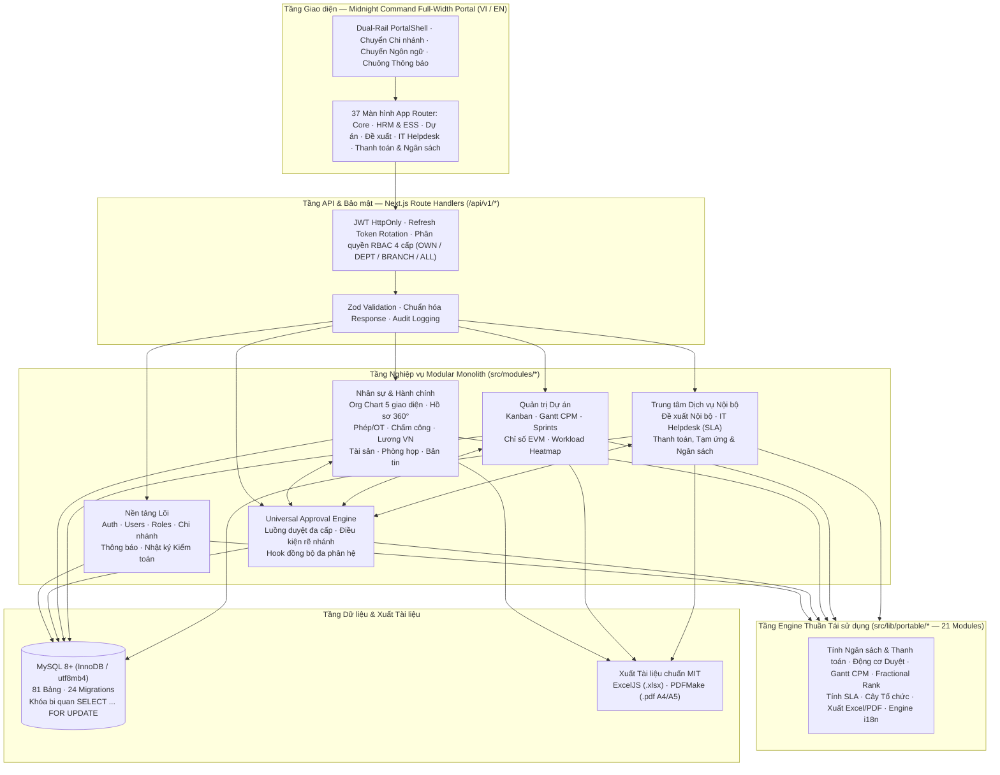
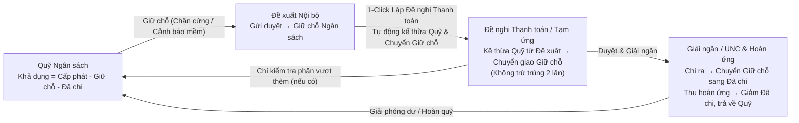

<div align="center">

# Operon Hub

### Cổng Quản lý Vận hành Doanh nghiệp SME theo Kiến trúc Mô-đun

*Một không gian làm việc toàn chiều rộng (Full-Width) hợp nhất **Nền tảng Lõi & Phân quyền**, **Nhân sự & Tiền lương (HRM)**, **Quản trị Dự án (Projects)**, **Đề xuất Nội bộ**, **IT Helpdesk** và **Thanh toán & Quản lý Ngân sách** — xây dựng trên kiến trúc Modular Monolith chuẩn mực.*

<br />

[](./README.md)
[-10b981?style=for-the-badge)](./README.vi.md)

<br />

[](./LICENSE)
[](https://nextjs.org/)
[](https://react.dev/)
[](https://www.typescriptlang.org/)
[](https://www.mysql.com/)
[](#4-chuẩn-kỹ-thuật--hệ-engine-tái-sử-dụng)
[-059669.svg)](#8-kiểm-thử--đảm-bảo-chất-lượng)

[Tổng quan](#1-tổng-quan) · [Kiến trúc](#2-kiến-trúc-hệ-thống) · [Phân hệ](#3-danh-mục-phân-hệ--tính-năng) · [Chuẩn kỹ thuật](#4-chuẩn-kỹ-thuật--hệ-engine-tái-sử-dụng) · [Cài đặt nhanh](#6-hướng-dẫn-cài-đặt--chạy-local) · [Câu lệnh](#7-các-lệnh-thường-dùng) · [Kiểm thử](#8-kiểm-thử--đảm-bảo-chất-lượng)

</div>

---

## 1. Tổng quan

**Operon Hub** là **Cổng Quản lý Vận hành Doanh nghiệp SME (Single-Tenant, Multi-Branch)** giúp doanh nghiệp vận hành liền mạch mọi quy trình cốt lõi trên một nền tảng duy nhất thay vì rời rạc nhiều công cụ.

Hệ thống được phát triển trên **Next.js 16 (App Router)**, **React 19**, **TypeScript 5.8**, **Kysely** và **MySQL 8+** theo kiến trúc **Modular Monolith**: tầng lõi (Xác thực, Phân quyền RBAC, Cô lập đa chi nhánh, Động cơ phê duyệt đa cấp, Thông báo, Nhật ký kiểm toán, Song ngữ VI/EN) hỗ trợ cắm mở rộng các phân hệ nghiệp vụ độc lập mà không cần chỉnh sửa lõi.

### Quy mô Hiện tại của Hệ thống

| Hạng mục | Chỉ số Thực tế |
| :--- | :--- |
| **Cơ sở dữ liệu** | `24` file SQL migration có rollback (`UP`/`DOWN`) · `81` bảng MySQL 8+ (`InnoDB`, `utf8mb4_unicode_ci`) |
| **Tầng REST API** | `221` Route Handlers chuẩn hóa dưới `/api/v1/*`, kiểm tra đầu vào bằng Zod |
| **Giao diện Portal** | `37` màn hình Full-Width (`Midnight Command` Dual-Rail UI) · Responsive · Song ngữ 100% VI/EN |
| **Phân hệ Nghiệp vụ** | `12` module backend tách biệt (`auth`, `users`, `roles`, `branches`, `approvals`, `audit`, `notifications`, `hrm`, `projects`, `proposals`, `it-requests`, `payments`) |
| **Engine Tái sử dụng** | `21` module thuần không phụ thuộc nghiệp vụ tại `src/lib/portable/` (kế toán ngân sách, thanh toán, Gantt CPM, LexoRank, SLA, i18n, PDF/Excel) |
| **Kiểm thử Tự động** | `78` bộ kiểm thử Vitest · `231` test cases đạt 100% · `131` Master Test Cases quản trị tập trung |
| **Chính sách Thư viện** | `100%` gói production chuẩn giấy phép **MIT**, được kiểm tra tự động qua script audit |

---

## 2. Kiến trúc Hệ thống



### Luồng Kế toán Liên phân hệ: Ngân sách ↔ Đề xuất ↔ Thanh toán

Phân hệ **Quản lý Ngân sách**, **Đề xuất Nội bộ** và **Thanh toán / Tạm ứng** liên kết qua **sổ cái cam kết nguyên tử (Encumbrance Ledger)** có khóa dòng `FOR UPDATE` giúp **loại bỏ hoàn toàn lỗi trừ trùng ngân sách** và kiểm soát vượt trần theo thời gian thực:



---

## 3. Danh mục Phân hệ & Tính năng

| Phân hệ | Đường dẫn | Trạng thái | Tính năng Cốt lõi |
| :--- | :--- | :---: | :--- |
| **Nền tảng Lõi & RBAC** | `/dashboard`, `/settings/*`, `/approvals` | **Hoàn thiện** | Đăng nhập JWT HttpOnly + Refresh Token Rotation, RBAC chi tiết 4 cấp phạm vi (`OWN`, `DEPARTMENT`, `BRANCH`, `ALL`), lọc đa chi nhánh trên Topbar, Động cơ Phê duyệt Đa cấp dùng chung, Thông báo thời gian thực, Nhật ký kiểm toán, chuyển ngôn ngữ VI/EN tức thì |
| **HRM — Tổ chức & Nhân sự** | `/hrm/organization`, `/hrm/employees`, `/my/*` | **Hoàn thiện** | **Sơ đồ Tổ chức 5 giao diện** (Cây đứng, Cây ngang, Thẻ ma trận, Danh bạ, Bảng dữ liệu) kèm tổng hợp quân số & ngăn chi tiết phòng ban; Hồ sơ nhân sự 360°; Cổng tự phục vụ ESS (`/my/profile`, `/my/attendance`, `/my/requests`); Hợp đồng lao động & cảnh báo hết hạn (`≤ 15 ngày`, `≤ 30 ngày`, quá hạn); Quá trình công tác |
| **HRM — Công, Phép & Lương** | `/hrm/requests`, `/hrm/attendance`, `/hrm/payroll` | **Hoàn thiện** | Quỹ phép năm tính thâm niên, tự trừ T7/CN/ngày lễ, chống trùng lịch, hệ số OT (`150%` / `200%` / `300%`), Chấm công Web, Import/Export Excel, khóa/mở khóa kỳ công, **Tính lương chuẩn VN** (BHXH/BHYT/BHTN theo trần, thuế TNCN lũy tiến 7 bậc), xuất bảng lương Excel & phiếu lương PDF A4/A5 tiếng Việt |
| **HRM — Hành chính Văn phòng** | `/hrm/office` | **Hoàn thiện** | Quản lý Tài sản & cấp phát/thu hồi an toàn đồng thời (`FOR UPDATE`, xuất biên bản bàn giao PDF, cảnh báo tài sản chưa thu hồi khi nghỉ việc); Đặt phòng họp thông minh (4 trạng thái, không xóa cứng, chống đặt quá khứ, lịch tháng & tình trạng phòng trực tiếp); Bản tin nội bộ kèm thống kê đã đọc |
| **Quản trị Dự án (Projects)** | `/projects`, `/projects/[id]` | **Hoàn thiện** | Bảng Kanban kéo-thả `O(1)` bằng Fractional Indexing (LexoRank), Biểu đồ Gantt tương tác tính **đường găng CPM** & tự động đẩy lịch phụ thuộc (`FS`/`SS`/`FF`/`SF`), Sprint Agile với Burndown & Velocity, theo dõi **EVM / Burn Rate**, bản đồ nhiệt công suất nhân sự (Workload Heatmap trừ cuối tuần/lễ/phép), báo cáo PDF & Excel |
| **Dịch vụ — Đề xuất Nội bộ** | `/services/proposals` | **Hoàn thiện** | Lập dự toán hạng mục chi tiết, gắn Quỹ ngân sách kèm xem trước tác động số dư trực tiếp, trình duyệt đa cấp, khóa bình luận & tải tệp chặt chẽ chỉ ở trạng thái `PENDING_APPROVAL`, nút **1-Click "Lập Đề nghị Thanh toán"** từ đề xuất đã duyệt, xuất PDF A4 & Excel |
| **Dịch vụ — IT Helpdesk** | `/services/it-requests` | **Hoàn thiện** | Danh mục yêu cầu IT & vòng đời phiếu, **Engine SLA theo mức ưu tiên** (`ON_TRACK`, `AT_RISK`, `BREACHED`, `MET`, `PAUSED`), phân công kỹ thuật viên, leo thang xử lý, thống kê KPI SLA, xuất báo cáo Excel & PDF |
| **Dịch vụ — Thanh toán & Ngân sách** | `/services/payments`, `/services/payments/budgets/[id]` | **Hoàn thiện** | Thanh toán trực tiếp, Tạm ứng & Quyết toán tạm ứng (kèm thu hoàn ứng), tính bảng kê VAT, đọc số tiền bằng chữ song ngữ VI/EN, theo dõi giải ngân nhiều đợt & Ủy nhiệm chi (UNC), khóa trao đổi/tải tệp chỉ ở `PENDING_APPROVAL`; **Quản lý Ngân sách tích hợp** (Chặn cứng/Cảnh báo mềm, chuyển giao giữ chỗ chống trừ trùng từ Đề xuất, điều chuyển quỹ chống deadlock, sổ cái bất biến & xuất Excel/PDF) |
| **Dịch vụ — Đặt xe Công tác** | `/services/car-booking` | *Kế hoạch* | Lịch điều phối đội xe, phân công tài xế, duyệt chuyến đi & nhật ký nhiên liệu/km |

---

## 4. Chuẩn Kỹ thuật & Hệ Engine Tái sử dụng

Operon Hub áp dụng bộ quy chuẩn kỹ thuật nghiêm ngặt xuyên suốt mã nguồn:

- **Tầng Engine Tái sử dụng (`src/lib/portable/`):** `21` module TypeScript thuần, không dính nghiệp vụ hay cấu hình dự án, được lập chỉ mục đầy đủ tại [reusable-registry.md](./.agents/rules/reusable-registry.md) — sẵn sàng tái sử dụng cho các dự án khác (`budget-calculator`, `payment-calculator`, `proposal-calculator`, `sla-calculator`, `approval-engine`, `gantt-scheduler`, `agile-metrics`, `workload-calculator`, `fractional-rank`, `org-chart-utils`, `i18n-engine`, `excel-exporter`, `excel-importer`, `pdf-generator`, `password-hasher`, `token-hash`, `currency-utils`, `date-utils`, `pagination`, `tree-utils`, `retry`).
- **Song ngữ VI/EN Không rò rỉ ngôn ngữ:** Toàn bộ giao diện và dữ liệu danh mục (`name` / `name_en`) chuyển đổi tức thì giữa Tiếng Việt và Tiếng Anh, được bảo vệ bằng bài kiểm thử AST tự động (`tests/unit/i18n.test.ts`).
- **Giao diện Full-Width đồng nhất:** 100% trang trong Portal sử dụng bố cục toàn chiều rộng (`w-full`, kiểm chứng bằng unit test), khối Luồng Phê duyệt đặt thống nhất toàn chiều rộng ở cuối trang chi tiết và khóa bình luận/tải tệp chặt chẽ ngoài trạng thái `PENDING_APPROVAL`.
- **An toàn Cơ sở dữ liệu:** 100% Parameterized Query (Kysely/SQL), dùng `DECIMAL(18,2)` cho tiền tệ, khóa bi quan (`SELECT ... FOR UPDATE`) cho giao dịch tài chính/tài sản, migration luôn có `UP`/`DOWN`, và cơ chế bảo vệ chỉ cho phép chạy migrate/seed tự động trên `localhost` / `127.0.0.1`.
- **Chính sách 100% Thư viện MIT:** Được kiểm tra tự động qua `node .agents/scripts/check-license.js --audit`.

---

## 5. Cấu trúc Thư mục

```text
operon-hub/
├── database/
│   ├── migrations/              # 24 SQL migrations có rollback (UP/DOWN) cho 81 bảng MySQL
│   ├── migrator.ts              # Công cụ chạy migrate/rollback có bảo vệ môi trường Local/Dev
│   └── seed-core.ts             # Khởi tạo dữ liệu mẫu idempotent (Vai trò, Chi nhánh, HRM, Dự án, Dịch vụ, Ngân sách)
├── src/
│   ├── app/
│   │   ├── (auth)/              # Màn hình xác thực đăng nhập
│   │   ├── (portal)/            # 37 màn hình Portal App Router Full-Width
│   │   └── api/v1/              # 221 REST API Route Handlers
│   ├── components/              # UI Components theo phân hệ (Core, HRM, Projects, Proposals, IT, Payments, Budgets)
│   ├── config/                  # Cấu hình môi trường & định nghĩa schema Kysely
│   ├── i18n/                    # Từ điển song ngữ VI/EN & React context
│   ├── layouts/                 # Giao diện Midnight Command Dual-Rail PortalShell & điều hướng RBAC
│   ├── lib/portable/            # 21 module engine tính toán & tiện ích thuần tái sử dụng đa dự án
│   ├── middlewares/             # Middleware xác thực JWT & kiểm tra phạm vi quyền RBAC 4 cấp
│   ├── modules/                 # 12 gói nghiệp vụ phân tách theo mô-đun
│   └── shared/                  # Chuẩn hóa JSON Response & xử lý lỗi thống nhất
├── tests/                       # 78 bộ kiểm thử Vitest (231 tests: portable, unit, API, i18n AST, layout)
├── .agents/                     # Tài liệu Blueprint, Task Specs, Nhật ký, Scripts & Kho Master Test Cases
├── README.md                    # Tài liệu Tiếng Anh (Mặc định GitHub)
└── README.vi.md                 # Tài liệu Tiếng Việt (Bản song song)
```

---

## 6. Hướng dẫn Cài đặt & Chạy Local

### Yêu cầu Môi trường
- **Node.js** `>= 20` (khuyến nghị `22+`)
- **MySQL** `8.0+` chạy tại máy cục bộ (`localhost` / `127.0.0.1`)

### Bước 1: Tải mã nguồn & cài đặt phụ thuộc
```bash
git clone https://github.com/hoadesign09/Operon-Hub.git
cd Operon-Hub
npm install
```

### Bước 2: Cấu hình biến môi trường
Sao chép file mẫu `.env.example` thành `.env` và điền thông tin kết nối MySQL Local cùng khóa bí mật JWT:
```bash
cp .env.example .env
```

### Bước 3: Chạy Migration & Nạp dữ liệu mẫu
```bash
npm run db:migrate
npm run db:status
npm run db:seed:core
```

### Bước 4: Khởi chạy ứng dụng
```bash
npm run dev
```

Mở trình duyệt tại **[http://localhost:3000](http://localhost:3000)**.

### Tài khoản Mẫu (Local Seed)
> **Lưu ý:** Chỉ dùng cho môi trường phát triển/đánh giá tại Local. Luôn đổi mật khẩu trước khi triển khai lên môi trường dùng chung hoặc staging.

| Vai trò | Email | Mật khẩu |
| :--- | :--- | :--- |
| **Quản trị Hệ thống** (Phạm vi `ALL`) | `admin@operonhub.local` | `Admin@123456` |
| **Tài chính & Kế toán** (Thanh toán & Ngân sách) | `finance@operonhub.local` | `Admin@123456` |
| **Chuyên viên IT Support** (Helpdesk & SLA) | `it.support@operonhub.local` | `Admin@123456` |

> **Thư viện Giao diện:** Truy cập `http://localhost:3000/design-studio` để xem các thành phần mẫu của hệ giao diện **Midnight Command**.

---

## 7. Các lệnh Thường dùng

| Lệnh | Mô tả |
| :--- | :--- |
| `npm run dev` | Chạy máy chủ phát triển Next.js |
| `npm run build` | Biên dịch bản production (Next.js 16 Turbopack) |
| `npm run start` | Khởi chạy máy chủ production sau khi build |
| `npm run typecheck` | Kiểm tra kiểu TypeScript nghiêm ngặt (`tsc --noEmit`) |
| `npm run lint` | Kiểm tra chuẩn mã nguồn ESLint 9 |
| `npm run test` | Chạy toàn bộ `78` bộ kiểm thử tự động Vitest (`231` tests) |
| `npm run db:migrate` | Chạy các migration MySQL chưa áp dụng (`UP`) trên Local/Dev |
| `npm run db:rollback` | Rollback migration gần nhất (`DOWN`) trên Local/Dev |
| `npm run db:status` | Xem trạng thái các migration đã áp dụng |
| `npm run db:seed:core` | Nạp dữ liệu mẫu idempotent (RBAC, HRM, Dự án, Đề xuất, IT, Thanh toán, Ngân sách FY2026) |

---

## 8. Kiểm thử & Đảm bảo Chất lượng

- **Bộ Kiểm thử Tự động:** `78` file · `231` bài kiểm thử đạt chuẩn bao phủ các engine thuần, nghiệp vụ lõi, phân quyền RBAC, kiểm tra rò rỉ song ngữ AST, chuẩn bố cục Full-Width và bộ xuất PDF/Excel.
- **Kho Test Case Tập trung (Excel):** [master-testcases.xlsx](./.agents/test-cases/master-testcases.xlsx) (`131` Master Test Cases qua `26` đợt kiểm thử).
- **Kiểm tra tuân thủ giấy phép MIT:**
  ```bash
  node .agents/scripts/check-license.js --audit
  ```
- **Tài liệu Kiến trúc Hệ thống (Blueprints):**
  - [Blueprint Core & HRM](./.agents/specs/blueprints/operon-hub-hrm.blueprint.md)
  - [Blueprint Quản trị Dự án](./.agents/specs/blueprints/operon-hub-projects.blueprint.md)
  - [Blueprint Đề xuất Nội bộ & Dịch vụ](./.agents/specs/blueprints/operon-hub-proposals.blueprint.md)

---

## 9. Giấy phép (License)

Dự án được phát hành theo giấy phép **MIT License** — xem chi tiết tại file [LICENSE](./LICENSE).

---

<div align="center">
<sub>Thiết kế tối ưu cho vận hành doanh nghiệp SME hiện đại · <a href="./README.md">Read English Version →</a></sub>
</div>
